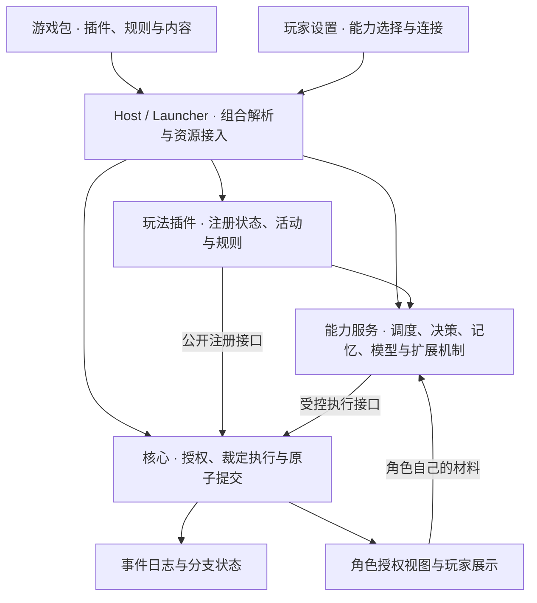

# Perspectra 可组合游戏引擎架构定稿

定稿日期为 2026-11-11。用户已确认本规范用于指导分批重构。实现差距见第 16 节，施工批次见[实施计划](../../superpowers/plans/2026-11-11-composable-engine-refactor.md)。

| 项目 | 说明 |
| --- | --- |
| 产品目标 | 拥有稳定核心、可组合玩法和可替换实现的角色中心 AI 原生游戏引擎 |
| 已明确要求 | 核心负责确定性，能力服务提供接口，玩法插件承载差异化，游戏包负责组合 |
| 组织原则 | 稳定能力定义、具体提供者和调用方分离，简单功能可以共处一个软件包 |
| 时间机制 | 时间推进采用现有机制，各能力消费现有时间和已提交事件 |
| 规范状态 | 已确认的架构目标与施工规范，运行时接通和验收按实施批次记录 |
| 本轮修订 | 明确核心硬预算与实例 Fiber 所有权，周期边界与玩家输入解耦，补齐记忆交付、决策部分成功、多模型路由与原生插件授权，采用有限恢复承诺 |
| 证据范围 | 根据当前 `feat/rpg-plugin` 工作树及现行架构文档进行静态核对 |
| 采用方式 | 由核心与插件规范统一导航，开发指令和共同契约采用本定稿，模块地图记录实际目录与迁移差距 |

## 1. 从一段角色互动理解目标

在雨夜庄园中，玩家向同房间的角色询问钥匙下落。角色依据自己的经历与记忆回应，可能表达犹豫，也可能尝试把钥匙交给玩家。交付钥匙需要规则确认持有者、交付对象和当前活动限制，随后一起提交物品变化与相关观察。语气、表情和迟疑保留自然语言表达。

另一名角色在楼上。游戏包启用了通信玩法时，玩家可以尝试给他发消息。通信渠道计算目标和送达条件，规则确认是否具备相应设备、是否受到屏蔽等条件。核心提交送达事实，并把消息投递给有权接收的人。自主策略可以提名收件人获得一次处理机会，由角色自己决定是否回复。

同一个世界之后开始跑团活动。跑团插件提供主持人、参与者、检定和局内工具，骰子插件计算点数，活动机制维护局内流程。主持人的宣布以及状态变化继续通过相同的授权与提交边界。

这些场景共同依赖实体、权限、状态和事件，也分别需要通信、自主、骰子与跑团规则。架构应让创作者通过游戏包组合这些能力，让开发者通过公开接口实现或替换它们。

### 1.1 创作者完成一个搜证玩法

创作者提出“搜查房间消耗一点精力，精力归零时拒绝搜查，发现的证物进入线索面板，同房间角色看到翻找动作”。目标创作流程如下。

1. 在一个包内脚本或原生模块中导出玩法定义，包含状态、操作、授权观察、NPC 说明与展示投影。
2. 在游戏包清单中显式启用该定义及所需能力。
3. 编写简短推演剧本，验证精力消耗、线索获取、目击范围与条件不足的拒绝结果。
4. 在默认舞台试玩，检查表单、线索展示和角色的真实回应。

完成共同契约和默认适配后，受支持的操作、表单和面板可以通过这份定义接通核心执行、默认决策上下文与玩家展示。新增玩法通过所选机制的公开入口装配，作者文档与发行工具提供对应类型声明和命令。

本规范把“一个实现文件、显式启用声明和推演剧本”作为这类轻量玩法的交付目标。机械推演、真实模型体验和前端可用性分别记录验证结果。

## 2. 总体原则与分层

### 2.1 核心原则

1. 核心保证重要世界事实的权威性、权限与原子提交。
2. 能力服务提供稳定的编程契约，实现可以替换。
3. 玩法插件注册规则、状态、活动和策略，形成具体玩法。
4. 游戏包声明本局采用的玩法、规则参数、内容和能力要求。
5. 宿主负责运行环境、连接、资源接入与端侧交付。
6. 角色自己决定回应、行动与表达，程序负责机会安排和结果裁定。
7. 可替换边界围绕实际消费者建立，同一包内也应保持清晰职责。

### 2.2 四层职责

| 层 | 核心职责 | 主要产物 | 依赖范围 |
| --- | --- | --- | --- |
| 确定性核心 Core | 实体、权威事件、授权、状态校验、行动执行、原子提交、分支与生命周期 | 受控读取和执行接口、已提交事实、授权观察 | SDK、通用基础设施、Cordis |
| 能力服务 Capability services | 调度、决策、记忆、模型、状态扩展、活动、通信等稳定能力 | 服务契约及具体 Provider | SDK 与明确授予的核心执行能力 |
| 玩法与策略插件 Gameplay plugins | 战斗、骰子、剧情节奏、自主策略、跑团及具体交互 | 状态定义、规则、活动、策略和公开协作接口 | SDK、公开能力服务、声明的插件接口 |
| 游戏包 Game pack | 选择插件和规则，提供角色、地点、物品、设定、资源与包内脚本 | 可校验的组合清单和内容 | 所选插件的公开内容格式 |

Host 与 Launcher 作为外围应用连接上述各层。插件装配使用现有 Cordis 容器，进程级登记可共享的工厂和定义，世界实例级绑定能力并注册该包的玩法定义，资源释放采用所属生命周期。

### 2.3 运行关系

下图表示目标职责之间的运行关系。能力服务框包含接口角色，其实现既可以来自内置 Provider，也可以来自玩家选择的替代 Provider。



图中省略了模型网络、长期记忆进程、缓存和前端播放等资源细节。它们分别归所选 Provider 与外围适配器管理。

### 2.4 进程与世界实例的作用域

| 作用域 | 持有内容 | 生命周期要求 |
| --- | --- | --- |
| 进程级 | 已发现插件代码、Provider 工厂、只读公共定义及明确允许共享的资源 | 共享资源由其拥有者管理，实例按公开契约使用 |
| 世界运行实例级 | 所选能力绑定、游戏包配置、状态与活动注册表、规则、任务和实例缓存 | 服务范围独立，由实例根插件的 Fiber 拥有生命周期与清理责任 |
| 单次执行级 | 角色身份、快照、刺激引用、取消信号和受控提交入口 | 执行结束或取消时收回使用资格 |

世界运行实例包括普通游戏、Lens 推演和重生候选。即使它们对应同一个分支地址，也各自持有独立的实例注册表和执行生命周期。

世界实例作用域负责服务解析、数据访问和注册表隔离，实例生命周期所有者负责插件、监听器、任务和资源释放。服务范围通过 Context 的 isolate／extend 等现有能力组织，生命周期通过实例根插件及其 Fiber 明确拥有。

每个实例装载一个实例根插件，保存该次 `ctx.plugin(...)` 返回的 Fiber。能力绑定、包专属定义、插件子实例和资源 effect 都在这个实例根插件的上下文或其所属子插件中创建。关闭实例时，先收回执行资格，再清理资源并释放保存的实例根 Fiber。

进程级工厂在 `open()` 时取得实例配置与服务。可以复用现有 BranchRuntimeSlot 保存并释放插件 Fiber 的方式，并按实际运行实例补齐服务范围。资源拥有者使用与创建时相同的归属完成清理。

监听器、定时任务、业务注册表和可变缓存也要明确实例归属。共享事件分发按实例身份限制交付，注册清理由所属 Fiber 的 effect 持有。模块级共享内容采用只读定义或具有明确拥有者的资源。

共享进程、连接池等资源明确区分共享拥有者和实例使用者。释放某个实例时清理其任务与引用，共享拥有者在相应资源生命周期结束时执行最终关闭。

## 3. 核心负责的稳定边界

### 3.1 实体、事实与授权

核心维护世界实体身份、地址、位置、物品归属及当前已声明的重要状态。World Event Log 记录已提交事实，SQLite 保存事件及相关投影，提交保持短事务和原子性。

核心按调用者身份生成授权视图。角色自己的观察、近期经历和授权记忆来源可以交给对应能力使用。可信规则读取真值时，接口应说明读取目的、数据范围与输出要求。

基础面对面互动包括同场景公开发言、指定对象耳语和移动。具体接触、物品操作、通信设备条件及战斗规则由所选玩法声明。

### 3.2 行动合法性的分工

核心负责绑定真实执行者、准备合法输入、执行适用规则、校验结果并提交。玩法规则定义具体行动在游戏中的条件、成本和效果。

以角色尝试离开战斗场地为例，RPG 插件声明战斗中的移动条件，核心在最新状态上执行该规则，并校验规则提出的位置和其他状态效果。更换战斗规则后，核心继续承担相同的执行与提交职责。

每个操作都要能回答以下问题。

- 谁提出操作，执行身份由谁绑定。
- 哪些规则参与候选生成，哪些规则参与正式裁定。
- 规则能读取哪些授权材料或真值。
- 本次操作包含哪些必须一起提交的效果。
- 哪些观察应交付给哪些角色。

### 3.3 事实与叙事

模型输出作为行动或表达的提案进入运行时。涉及重要状态变化的结果，由适用规则裁定并通过核心提交。

对白、姿态、表情、语气和细微动作继续使用自然语言。创作者只为实际追踪的机制声明结构化状态。角色的主观态度由人设、经历、记忆和对白呈现，沿用项目对角色主体性的要求。

真实试玩需要分别检查程序权限和叙事一致性。角色持续相信虚构的移动或物品交付，属于需要调查的体验问题。

### 3.4 第三方信任模型

原生第三方插件按照可信代码运行，官方接口收敛其正常调用路径与资源范围。核心和官方 Provider、插件共同维护事实与认知边界。

原生插件可以使用宿主进程的语言与运行环境能力，其作者承担代码行为责任。包内轻量脚本继续采用现有脚本环境和明确的能力桥接。接口文档应分别说明这两类扩展的权限与执行条件。

原生插件的安装、用户允许执行与某世界启用分别记录其语义。游戏包声明对插件的依赖，宿主根据已安装且用户允许的实现完成装配。管理端展示插件来源、版本、依赖和原生执行权限范围，既有允许状态可在正常启动时复用。

静态清单读取先于可执行模块导入。配置校验模块、Provider 工厂和其他原生入口也受相应执行授权约束。包内脚本通过其公开脚本入口装载，使用该环境明确提供的能力。

## 4. 稳定接口、提供者与调用方

### 4.1 三者分别定义

| 角色 | 回答的问题 | 例子 |
| --- | --- | --- |
| 能力接口 Service contract | 引擎与插件可以调用什么，输入输出和权限是什么 | `SchedulerService`、`StateService` |
| 能力提供者 Provider | 谁实现该能力，如何打开和关闭一个世界实例 | 官方默认调度器、第三方记忆实现 |
| 能力调用方 Consumer | 谁使用接口组织玩法或完成运行流程 | RPG 注册状态，跑团注册活动，核心请求角色决策 |

同一软件包可以包含多个 Provider。同一个插件也可以注册多种玩法定义，接口职责按调用和状态边界划分。

### 4.2 替换与扩展分别注册

采用以下注册语义，具体类型签名在实施批次中结合现有 SDK 固定。

| 注册对象 | 数量语义 | 组合方式 |
| --- | --- | --- |
| scheduler、decision、memory、llm 提供者 | 每个世界实例选择一个有效提供者 | 按明确配置选择，重复选择时报告冲突 |
| state、activity、communication 提供者 | 启用对应能力时选择一个有效提供者 | 替代实现遵循同一注册与调用契约 |
| 状态模块、操作、活动定义、通信渠道 | 多个 | 按稳定标识注册并检查重名 |
| 唤醒来源与限制规则 | 多个 | 来源供调度器消费，适用限制按合取组合 |
| 操作处理器 | 每个操作 ID 唯一 | 带命名空间的操作 ID 绑定一个处理器，重名在装配时报告 |
| 后置派生与周期结算钩子 | 按插件与钩子标识登记多个 | 在实例作用域中绑定，按主操作或执行周期的规定调用 |
| 决策上下文步骤与决策包装器 | 多个 | 由所选 decision 提供者按显式配置组织 |

单例的 decision 提供者可以支持多步骤组合。现有有序上下文与决策包装能力需要在新接口中获得明确对应关系。

单个 llm 提供者代表统一调用入口，内部可以按角色路由到多个模型、供应商和连接适配器。角色模型配置由玩家与宿主提供。

### 4.3 服务是否必需

服务要求根据入口与玩法确定。

- AI 角色互动入口需要有效的调度与决策能力。使用模型的决策实现声明 LLM 依赖。
- 长期记忆可以选择正式记忆实现，也可以显式选择 `memory-none`。
- 状态、活动与通信根据游戏包内容和所选插件的依赖启用。
- 编译、静态检查、无模型机械测试等入口按自己的运行需求装配。

游戏包编译检查和启动诊断应同时说明所需能力、选择的实现及缺失项。

### 4.4 各能力的输入与结果

下表给出目标契约的最小语义。具体方法名与类型签名在核对现有消费者后确定。

| 能力 | 主要输入 | 主要结果 | 直接调用方 |
| --- | --- | --- | --- |
| scheduler | 本轮角色、机会候选、授权刺激引用、取消信号与受控激活入口 | 激活记录、停止原因与消耗情况 | 引擎执行协调 |
| decision | 单角色授权上下文、刺激、已提交行动结果与受控操作入口 | 表达、行动尝试和激活结束结果 | 角色激活执行 |
| memory | 单角色授权来源、近期材料和检索请求 | 该角色的记忆交付及归档进度 | decision 与记忆维护流程 |
| llm | 请求消息、输出要求、角色模型选择及取消信号 | 模型响应、用量及调用状态 | decision 和已声明的模型调用方 |
| state | 状态定义、操作参数、授权候选输入与可信裁定输入 | 状态候选、裁定结果与待检查效果 | 玩法插件与核心执行入口 |
| activity | 活动定义、参与者、局内操作及范围明确的状态 | 操作候选、活动结果与机会提示 | 玩法插件、核心执行与 scheduler |
| communication | 渠道定义、真实发送者、合法目标候选和消息 | 操作候选与投递提案 | 玩家或角色操作执行 |

各契约同时说明拒绝与异常的区别、取消处理、世界实例隔离及 close 行为。调用方依据正式执行结果更新流程。

业务条件不足等预期拒绝使用结构化结果，插件未处理异常和无效返回值按插件故障处理。各调用点同时声明其结果是否为后续流程所必需，故障处理采用第 15 节的相应语义。

### 4.5 强类型自描述玩法定义

公开作者契约以同一份玩法定义收拢实现及其使用说明。模块可以包含多个操作，共享状态和展示定义。StateService、ActivityService、DecisionService 和展示适配器分别消费其对应部分。

| 定义内容 | 描述的信息 | 消费方 |
| --- | --- | --- |
| 身份与配置 | 稳定 ID、必要能力、configSchema、数据兼容声明及纯配置校验入口 | 游戏包工具链与宿主装配 |
| 状态与初始化 | 状态结构、作用范围、初值和可见性 | 状态能力与核心初始化 |
| 操作 | 参数 Schema、授权候选、限制和唯一处理器 | 操作投影与核心执行 |
| NPC 描述 | 操作的用途说明和接收者可知的结果表述 | 默认决策上下文组装 |
| 玩家描述 | 动作标签、目标分组、只读面板和控件 | 玩家视图投影与默认舞台 |
| 派生与结算 | 关注的主操作或变更范围、afterAction 与 onCycleEnd | 核心操作执行和周期协调 |

这些字段组成作者使用的定义契约，各部分按需声明。具体顶层类型名和导出签名在公共契约实施批次固定。现有 policy 的授权候选职责收敛到对应操作的 offer 及活动策略入口。

公开操作类型按 `OperationDefinition<TParams, TState, TOutcome>` 的关系组织。类型参数分别表达操作参数、所需状态投影和业务结果。各成员需要具有以下语义。

| 成员 | 类型与调用要求 |
| --- | --- |
| id | 带命名空间的稳定操作 ID，沿用公共 ID 约定 |
| argumentSchema | 参数的 JSON Schema，共用于运行校验、NPC 参数说明和玩家表单 |
| npc.whenToUse | 描述用途与已知成本的文本，随角色合法候选交付 |
| npc.formatResult | 接收该接收者有权知道的结果投影，返回普通文本 |
| ui | 动作标签、可选目标分类与分组提示 |
| offer | 消费当前主体的只读授权视图，返回明确类型的参数候选 |
| resolve | 消费绑定身份的可信裁定输入，返回明确的 accepted／rejected 联合结果 |

状态初始化、活动结果及展示投影同样给出具体返回类型。公共作者接口中的类型减少未说明的数据形状，脚本导出、JSON 和第三方返回值进入宿主时继续作为待校验输入处理。

参数 Schema 为各侧提供共同的参数约束，原生类型声明提供编辑与编译检查。注册边界复用现有 Schema 校验能力，实施时核对泛型参数、Schema 与实际输出的对应关系。

2026-11-12 B1 已固定上述作者类型：[gameplay.ts](../../../packages/plugin-sdk/src/gameplay.ts)提供异构操作玩法定义、参数／结果 Schema、授权 offer、可信 resolve、NPC／玩家说明、必要服务、数据版本、玩家展示及模块级 afterAction／onCycleEnd；[results.ts](../../../packages/plugin-sdk/src/results.ts)固定业务拒绝、插件故障与周期结果声明；[gameplay-contract.ts](../../../packages/application/src/gameplay-contract.ts)只编译参数／结果 Schema并校验、复制外部 unknown。具体见 [B1 记录](../../superpowers/plans/2026-11-12-composable-engine-b1-contract.md)。B2 已接入实例 Context／Fiber、装载许可与调用保护，并通过主代理定向验收，见 [B2 记录](../../superpowers/plans/2026-11-12-composable-engine-b2-lifecycle.md)。B3 的公共资源装配、实际调度驱动与周期源码已通过独立审查；B4 原生注册与受控效果适配源码已接通，独立审查通过；状态初值明确归属，活动结果有独立 Schema／接收者投影，公开计算方法与后置冲突通过所属模块组织。实际范围见 [B4 记录](../../superpowers/plans/2026-11-13-composable-engine-b4-gameplay.md)。通用 UI 与作者配置的 B8 接通边界见[展示与配置指南](../guides/gameplay-presentation.md)。

### 4.6 自描述的授权与接入

默认 DecisionService 从角色自己的合法候选中收集操作用途与参数说明，并通过通用模板组织上下文。替代实现可以消费相同授权描述接口。创作者为操作增加说明后，其接入沿用同一路径。

搜证说明可以写“搜查当前位置，消耗一点精力，结果以实际裁定为准”。隐藏线索的存在与位置，通过符合发现条件的正式结果交付。

结果格式化按接收者分别执行。搜查者可以得到线索详情，同房间目击者可以得到翻找动作，房外角色按规则获得各自可知内容。格式化文本服务表达，结构化状态与受众资格由核心按正式结果验证。

formatResult 作为可选呈现步骤，故障时报告插件告警，并由核心根据已经授权的正式结果提供基础状态说明。已提交事实按真实执行结果反馈。

## 5. 受控执行边界与可替换调度

### 5.1 核心执行边界

`RoundExecutionGate` 在本稿中代表受控执行职责。实现优先整合已有角色激活、玩家提交和即时操作的公共边界，具体类与函数按源码结构确定。

核心执行边界负责以下事项。

1. 绑定世界实例、分支、执行角色和当前有效生命周期。
2. 根据事件序号读取该角色有权使用的刺激。
3. 提供角色执行所需的授权上下文与操作入口。
4. 在准备提交时重新检查状态前缀、执行资格和写入权限。
5. 执行适用规则并验证状态、位置、物品及观察效果。
6. 通过现有写租约和存储边界原子提交。
7. 让关闭、取消与重生切换后的在途工作失去提交资格。
8. 在正式激活入口统计资源消耗，检查硬预算并约束并发启动。

模型调用和其他耗时计算在 SQLite 事务外完成。写租约使用现有执行路径的适当作用域，并发决策分别计算，提交阶段保持一致性检查。

取消时，核心主动结束对可取消异步调用的等待并收回本次提交资格，继续执行资源清理。迟到结果的处理与写租约释放顺序见第 15.3 节。

### 5.2 SchedulerService

调度器决定谁获得一次处理机会、执行顺序、串行或并发，以及一次执行周期何时正常结束。周期可以由玩家输入、系统刺激或已允许的持续运行入口启动。

调度器消费受控激活接口和必要的调度信息。刺激内容由核心根据角色与事件引用读取。角色自己的处理结果再反馈给调度器，用于安排后续机会。

调度器负责机会分配与策略预算，可以主动少用已获额度。核心执行边界负责实际激活次数、并发数和执行期限的硬上限，所有通过正式入口运行的调度器遵循同一限制。超限请求返回明确的预算耗尽结果，已提交行动按事实保留。

预算属于宿主授予的一次执行请求或持续运行会话。调度器在此范围内切换周期时沿用剩余额度，新的额度由宿主按玩家或入口配置授予。具体数值通过实际场景与试玩确定。

启动激活前，在同一个受控执行边界内检查并占用额度。激活总数在该授权范围内累计，并发额度在任务真正结束或已收回相关执行资格后按资源状态释放。取消后仍运行的底层模型请求由适配器继续计入其实际在途资源，按第 15.3 节收尾。

模型调用次数在实际发送边界计量，重试同样消耗相应额度。Token 与费用限制依据适配器能提供的计量和请求约束，记录估计值与实际用量的差异。具体接口只承诺其能够实施的资源限制。

定稿采用核心硬预算，开发指令已同步这一要求。B3 源码已在实际激活入口接通请求硬预算，SDK 调度参数保留策略含义，实际接通和独立验收范围见 B3 施工记录。原生可信代码的同进程执行限制见第 12.6 节。

### 5.3 统一激活入口

目标入口可表达为 `activateCharacter(characterId, options)`。这是接口语义示意，参数类型与命名供后续设计。

激活参数应围绕以下材料组织。

| 材料 | 含义 | 检查归属 |
| --- | --- | --- |
| 角色标识 | 本次获得机会的角色 | 核心绑定并确认有效性 |
| 授权刺激引用 | 已属于该角色的观察序号 | 核心逐条确认归属 |
| 激活原因 | 新观察、活动机会或自主策略等来源 | 作为机会来源和诊断信息 |
| 执行限制 | 策略分配、宿主硬预算、期限与取消信号 | 调度器分配机会，核心检查实际激活和执行资格 |

自主行动可以使用空刺激。涉及新的察觉、消息或念头时，通过相应机制生成和投递材料，再引用该角色收到的内容。

活动合法行动者由活动规则确定，调度器据此选择机会。提交时继续检查当前活动条件，以处理决策期间发生的状态变化。

## 6. Autonomy 与唤醒来源

### 6.1 职责

Autonomy 作为策略插件，负责判断角色何时额外获得处理机会。周期性机会、收到远端消息后的机会和作者声明的目标触发，都可以通过唤醒来源注册实现。

以公开的 `WakeupSource` 契约表达提名。调度器在约定的候选收集点调用来源，再在核心硬预算内安排顺序和机会分配。

### 6.2 提名内容与作用范围

唤醒提名提供角色、来源、已有授权刺激引用及必要的调度提示。诊断原因通过创作者调试路径展示。

角色行为权限、目标可见性和动作合法性使用规则及核心授权检查。现有 autonomy 中的频率、机会选择与行动许可应分别识别，机会策略和规则限制进入各自对应接口。

### 6.3 多来源组合

同一轮可能同时出现消息、活动和自主机会。官方调度器合并相同角色的候选刺激，根据具体玩法配置安排处理。多来源提名本身只表示机会候选。

调度策略使用当前可观察的角色状态和已提交事件。涉及需要跨读档保持的冷却或次数时，优先从现有事件推导，确有独立事实需求的数值通过已声明状态保存。

可选唤醒来源发生故障时，本轮跳过该来源的提名，并向宿主诊断和端侧发送非致命告警。其他独立来源可以继续提供候选。活动合法行动者、行动许可等必需规则采用裁定路径的故障语义。

## 7. Decision、Memory 与 LLM

### 7.1 DecisionService

DecisionService 负责组织一次角色激活中的上下文、表达、行动尝试与后续处理。默认实现可以吸收现有角色循环、上下文步骤和知识选择的相关代码，并在包内保留清晰模块。

默认决策流程包括以下步骤。

1. 读取角色授权视图和本次刺激。
2. 请求所选记忆能力交付该角色的相关经历。
3. 筛选该角色有权使用的知识与机制信息。
4. 组织上下文，调用模型或其他决策算法。
5. 将表达或行动提案交给核心受控入口。
6. 根据正式执行结果决定续写、再次尝试或结束。

具体循环次数、表达先后与上下文步骤属于默认决策策略。任何已提交操作继续由事实系统记录，后续决策失败按实际结果反馈。

上下文步骤声明必需或可选。必需记忆交付、权限相关输入等失败时停止当前决策，显式可选的修饰步骤失败时可以跳过并告警。近期窗口的裁剪需要以相应历史材料已成功交付为依据。

操作用途、参数与结果说明来自第 4.5 节的公共定义，经授权投影后交付。模型层的通用模板负责组织材料，具体玩法说明归对应定义维护。

公共决策契约保留 perform、publish 与 abstain 的正式含义。

| 决策流程 | 正式行为与结果 |
| --- | --- |
| 仅 publish | 按发言受众规则提交表达并形成相应观察，物理效果按独立行动裁定 |
| 仅 perform | 通过规则执行行动，成功后可以提供已授权的系统基础结果说明 |
| perform 后 publish | 后续决策接收正式行动结果，表达基于该结果组织 |
| perform 被拒绝 | 返回结构化拒绝及可知原因，后续决策取得该结果并据此继续或结束 |
| perform 成功，后续模型调用或 publish 失败 | 保留行动事实，分别报告行动成功与表达阶段失败，提供基础结果说明 |
| abstain | 结束当前激活，保留此前已经提交的合法行动与表达 |

行动提交、表达提交和激活终态分别反馈。复用现有 performResult、controlledCommitted、publicationRejected 等对应信息，并核对它们在新契约中的具体类型。替代 DecisionService 消费同一受控接口，以核心返回的提交结果推进流程。

行动已经提交、后续决策过期时，继续处理该行动的正式结果。恢复或重试所依据的已有提交信息通过当前执行与存档能力取得。

程序验证正式结果、受众和提交资格。行动被拒绝后的叙事一致性，以及角色续写是否持续符合事实，继续通过真实模型试玩单独验证。

### 7.2 MemoryService

核心负责捕获授权记忆来源，记忆实现负责检索、整理与交付。每项长期记忆都属于相应角色的授权材料范围。

记忆提供者的归档、后台任务、快照和恢复继续衔接现有存档分支能力。整理任务和缓存按当前需要管理，临时计算随生命周期结束可以丢弃。

已提交观察及其授权来源是可恢复的记忆输入。提供长期归档的实现公开已成功安装的覆盖边界，原有来源身份用于重复捕获检查与增量处理。排队中、计算中或尚未成功安装的整理任务保留其临时性质。

例如角色目睹玩家交出钥匙后游戏退出，世界恢复先保留正式交付与该角色的授权观察。记忆实现根据最后可用归档和授权来源识别缺口，可以重新整理未覆盖材料。近期上下文的裁剪依据已经安装且可正常交付的归档，尚未归档的必要材料继续从授权近期来源准备。

读取归档和安装后台结果时检查角色、世界实例对应的分支、授权来源与有效前缀。归档引用范围应满足当前可用世界前缀，旧实例和旧分支的迟到结果按失效调用处理。

knownTickStart／knownTickEnd 等来源时间字段沿用角色获知材料时的时间语义，归档重建时间单独记录。具体 Source、Atom、Episode、Observation 流水线归所选记忆实现组织，公共接口说明来源范围、已安装覆盖边界和当前交付结果。

这些约定复用现有授权来源、归档前缀和快照恢复。后台计算可以从已保存边界重新生成，其调度计划按有限恢复承诺处理。

`memory-none` 提供显式的无长期记忆选择。角色近期上下文仍按对应决策配置组装。

### 7.3 LlmService

LLM 能力负责模型请求及其传输适配。模型协议、连接缓存、用量记录与预设相关实现可以共处 `providers/llm`，内部保留角色调用和底层传输的可替换边界。

世界实例选择一个统一 LLM 能力入口。入口接收真实角色身份与调用配置，按玩家的角色模型映射选择连接、模型和协议适配器，内部可以同时使用多个供应商与后端。

现有默认连接、角色专属连接和按角色预设继续通过这一调用路径表达。底层适配器和连接资源按其拥有者管理，单例服务的数量与模型后端的数量分别描述。

凭证通过宿主与所选模型适配器接入。世界包保存非秘密配置和连接要求，公开插件身份、存档分享及角色上下文使用各自允许的数据。

角色输出先接受协议校验，再进入受控表达或行动执行路径。Provider 错误、格式错误、取消和规则拒绝分别向调用方反馈。

实际请求发送、重试和用量回传衔接第 5.2 节的资源限制。网络与模型适配负责它们能够真实计量和控制的调用资源。

## 8. StateService 与原生状态注册

### 8.1 玩法声明

玩法插件通过原生编程接口注册状态模块，声明稳定标识、Schema、初始值、作用范围、角色可见性和受控操作。

例如 RPG 插件内聚声明背包与战斗状态，使用药剂时由同一个操作计算扣除药剂、恢复生命值和相关观察，核心把本次不可分割的结果一起提交。

### 8.2 状态与权限

| 内容 | 归属 |
| --- | --- |
| 稳定状态标识、Schema、初值与业务含义 | 玩法插件声明 |
| 操作参数和业务裁定 | 注册的玩法规则 |
| 真实调用者、写入范围、值校验与提交 | 核心 |
| 角色可读范围与授权投影边界 | 核心执行公开可见性声明 |
| 状态注册、操作查找和提供者内部组织 | 所选 StateService 实现 |

命名空间用于区分状态身份和定位所属模块。角色读取、行动资格、状态变更与提交权限继续通过对应公开接口检查。

独立插件需要跨状态协作时，由状态所属模块提供公开的受控方法。该方法接收范围明确的裁定输入，检查业务条件并生成待提交效果，调用方把关联效果组合为一个操作结果。所有参与方法使用同一个有效状态快照，提交前由核心复核状态转换与相关物理效果。

状态校验同时覆盖 Schema、业务不变量和合法转换。例如药剂数量需要满足现有库存与扣除次数，生命值恢复需要满足当前角色状态与操作条件。普通数据类型和数值范围只承担其中的结构检查。

当前跨插件写入采用所属模块公开操作的协作方式。运行时授权检查集中保护真实调用者、角色可读范围、合法操作和核心提交边界。原生可信插件按第 3.4 节的信任模型运行。

可见性声明应优先表达可检查的范围。需要自定义投影函数时，其输入范围与输出用途分别约定。角色侧候选生成读取授权状态，可信裁定函数按所需权限读取真值。

### 8.3 持久化与重放

通用插件状态注册复用现有状态、事件和分支存储能力。核心认识并验证状态结果，事件中的数据保持可序列化，注册函数随所选插件实现装配。

定稿将原生插件状态注册纳入施工。实际数据表达、可见性表达与注册签名在对应批次结合现有 `StatusState` 和玩法消费者固定。

存档记录需要恢复的插件 ID 及其数据兼容版本，版本涵盖持久状态结构和必要语义。插件实现声明其支持的兼容版本，正常读档依据该声明和实际数据校验判断是否可恢复。

数据兼容版本覆盖状态含义、活动阶段和必要定义标识等持久化约定。例如生命值由绝对数改为百分比，即使 JSON Schema 相同，也需要重新处理其兼容性。逻辑修复与文案调整可以保留相同数据兼容版本。

存档打开时检查所需状态与活动定义、必需插件及数据兼容版本。缺失或不兼容时明确指出具体对象，迁移方式依据实际保留需求确定。代码或生成文本摘要可用于诊断与既有重生可比性检查，普通读档通过数据兼容契约判断。

## 9. ActivityService 与多角色活动

### 9.1 原生活动定义

ActivityService 接受原生 TypeScript 活动定义，表达初始化、候选操作、操作裁定、公开表达后的处理、调度提示、结果呈现及现有恢复能力。

活动可注册局内专用工具，供合法参与者选择。跑团的检定、宣布与私有笔记，战斗的技能和回合操作，都通过同一类公开活动机制组织。

### 9.2 核心与提供者的分工

核心负责活动事实、参与者身份、私有材料访问和关键提交边界。ActivityService 提供活动定义的装载、调用与可替换选择策略。玩法定义活动阶段、业务条件及局内合法行动者。

现有活动生命周期中的权限和提交检查应逐项保留其职责。玩法可以注册业务钩子，钩子的返回值作为待检查结果进入核心。

### 9.3 调度与局内信息

活动可以提示下一个合法参与者或聚光候选，scheduler 决定执行机会。角色收到一次机会后仍可回应、尝试操作或弃权。

角色侧 policy 和决策上下文只包含该角色有权接触的公开状态与私有材料。可信裁定可以读取必要的局内真值，其结果通过明确受众交付。

前台活动选择继续采用现有语义。更复杂的多活动并行需求根据具体玩法再定义。

## 10. CommunicationService 与观察投递

### 10.1 三部分职责

| 部分 | 职责 | 典型例子 |
| --- | --- | --- |
| 渠道 | 提供可用通信方式、目标计算和操作说明 | 短信、电话、广播、传音 |
| 受众 | 描述本次合法投递对象及观察内容 | 接收短信的人、听见广播的人 |
| 感知与认知 | 接收授权观察、捕获来源，再由角色理解和记忆 | 收到消息、回忆内容、决定回复 |

基础面对面发言与耳语采用核心现有规则。非面对面通信通过所选 CommunicationService 注册渠道。

### 10.2 渠道与规则

渠道定义通信参数、联系人候选、路由计算和必要说明。手机、信号、魔法条件与活动限制，由对应世界规则及状态操作参与裁定。

发送者使用真实绑定身份。收件候选从其可用联系人和合法目标中生成，提交时根据渠道规则和当前状态再次确认。

### 10.3 投递流程

通信裁定产生投递提案，包含受众与观察载荷。核心检查收件资格、发送身份和内容结构，原子记录通信相关事实与授权观察。

授权来源捕获消费已提交观察，记忆提供者据此整理材料。启用了相应自主策略时，消息送达可以提名收件角色获得处理机会。

通信结构在当前同步能力范围内设计，电话持续连接、延迟投递等语义随实际渠道需求确定。

## 11. 规则组合与操作执行

### 11.1 所有重要变更都有对应路径

规则入口可以按操作保留各自的数据模型，但每个入口都应声明适用规则与提交检查。

| 操作 | 主要业务规则 | 核心提交检查 |
| --- | --- | --- |
| 发言、耳语、移动 | 基础规则与所选玩法限制 | 执行者、目标、受众与物理效果 |
| 状态操作 | 状态模块注册的裁定函数 | 状态归属、写资格、Schema 与相关效果 |
| 活动操作 | 活动定义及关联规则 | 参与者、活动状态、私有材料和关联效果 |
| 通信操作 | 渠道条件及世界规则 | 发送身份、目标资格、投递结果和观察 |
| 节奏触发与其他系统操作 | 所选玩法声明的触发与效果规则 | 系统调用来源、状态效果、受众与提交一致性 |

跨机制限制需要明确落点。例如战斗限制移动，RPG 在移动规则中声明限制。战斗限制通信，则应在通信裁定可消费的公开规则入口中声明相应条件。

### 11.2 限制合取与唯一操作处理器

默认玩法规则采用两类公开入口。

| 入口 | 职责 | 组合语义 |
| --- | --- | --- |
| 限制规则 Restriction | 判断该主体在当前条件下能否尝试目标操作 | 对所有适用限制执行逻辑合取，任意拒绝即可阻止操作 |
| 操作处理器 Handler | 计算一个明确操作的业务结果和待提交效果 | 每个带命名空间的操作 ID 唯一绑定一个处理器 |

例如 RPG 注册移动限制，TRPG 注册局内通信限制。两者分别作用于对应操作，创作者按玩法声明进行组合。游戏包 `plugins` 对象的键排列只表达清单内容。

限制规则消费同一个有效快照和范围明确的输入，保持纯检查语义。随机数消耗、输入修改和其他副作用应归入适当的操作计算。正式执行前复核全部适用限制，限制规则故障按当前操作故障处理。

默认按稳定规则标识遍历限制，返回首次得到的拒绝原因。需要汇总诊断的调用可以收集全部拒绝原因。操作允许与否取决于合取结果，实际遍历顺序用于获得稳定的原因呈现。

操作处理器按 ID 注册，重名在装配时报告。技能修正等计算顺序由所属操作的实现组织，需要跨插件协作时通过公开方法完成。决策包装步骤继续遵守决策能力自己的顺序契约。

组合时应诊断以下冲突。

- 同一服务选择了多个有效提供者。
- 状态、活动、渠道或操作的稳定标识重名。
- 多个插件声明互斥的活动控制要求。
- 一个操作缺少其声明的限制规则、处理器或能力依赖。

插件依赖描述所需实现，Cordis inject 描述服务就绪。核心检查最终身份、状态转换、关联效果与观察受众，再执行提交。

### 11.3 计算、随机与提交

模型、检索及其他外部准备计算在事务外完成。正式规则裁定消费当前有效状态，使用其声明的输入返回结果。

骰子插件负责骰式、修正和点数计算，随机抽取衔接现有核心记录路径。规则与活动使用明确提供的随机输入，存档分支与重生沿用已有语义。

一次逻辑操作中不可分割的效果一起提交。多个连续行动逐次形成正式结果，后续计算按已经提交的事实继续。

### 11.4 单步操作与单层后置派生

正常单步操作经过以下阶段，周期结算在相应执行周期边界另行执行。

| 阶段 | 处理内容 | 输出与失败边界 |
| --- | --- | --- |
| Restrictions | 在有效快照上执行所有适用限制的合取检查 | 结构化拒绝时结束操作，故障时按操作失败处理 |
| Handler | 唯一处理器计算主结果 | 预期拒绝返回正式结果，成功时生成基础候选效果 |
| afterAction | 已声明的后置规则读取主结果及其变更前后候选快照 | 同步返回派生效果和观察提案，使用一层派生语义 |
| 验证与提交 | 核对主效果及派生效果的结构、权限、状态转换和受众 | 在同一个 SQLite 短事务中提交本步全部合法效果 |

核心先对处理器输出做必要结构和权限检查，再构造主结果后的候选快照。afterAction 中的“变更后”表示待提交候选状态，实际世界前缀在原子提交完成后更新。

后置规则按声明关注的操作或主变更调用，所有规则读取同一个变更前快照及主结果后的候选快照。各规则产出的派生结果在本阶段收集，完成后统一校验并提交。

每个适用后置规则对本次主操作调用一次，其派生结果直接进入合并与校验阶段。观察提案按正式授权范围投递，后续角色机会通过原有调度路径产生。

后置规则采用同步计算，随机需求使用现有受控随机来源。异步准备继续放在相应外部计算路径中。后置规则异常、无效输出或合并冲突采用裁定路径的故障语义，主结果和该步其他待提交效果一并放弃。

### 11.5 派生合并与状态不变量

计算修正与后置派生按业务位置组织。

| 扩展 | 输入与职责 | 组合归属 |
| --- | --- | --- |
| 计算修正 | 在主操作形成最终业务结果前，计算护盾、装备、抗性等修正 | 所属操作或状态模块的公开协作方法，定义计算顺序与合并方式 |
| 后置派生 | 依据已经确定的主结果，提出额外状态或观察效果 | 统一 afterAction 阶段，采用共同快照与单层合并 |

例如伤害模块先组织护盾和装备修正，得到最终伤害，再一并形成生命值与倒地状态。其他插件通过该模块实际提供的计算接口参与，核心继续执行通用阶段及最终验证。

多个后置规则之间保持候选快照隔离。遍历顺序用于稳定诊断，各规则的输入由主处理器结果确定。

派生结果可以在主结果基础上提出合法状态转换。多个派生结果写入同一个状态地址时，需要由状态所属模块的公开组合方法计算一个明确结果，缺少对应组合语义则报告冲突。核心对最终结果验证业务不变量、状态转换与关联效果。

例如主动作造成两点伤害，后置规则追加一点伤害。倒地规则若只读取主动作后的快照，它依据的生命值仍是追加伤害之前的值。涉及“最终伤害归零即倒地”的玩法，可以由伤害模块在生成最终合法变更时一并处理倒地状态，或通过其公开组合方法完成。

角色生命值、物品归属等不变量继续由相应状态模块与核心检查保障。一般后置规则只承担其声明的单层响应，跨派生的业务因果由所属处理器或明确协作方法组织。

### 11.6 执行周期与统一 onCycleEnd

| 执行单位 | 含义 | 对应扩展位置 |
| --- | --- | --- |
| 单步操作 | 一次发言、移动或玩法操作及其原子结果 | Restrictions、Handler、afterAction |
| 单角色激活 | 一次处理机会中的决策、操作及续写 | DecisionService |
| 执行周期 Execution Cycle | 调度器组织的有界执行单元，可以由玩家或系统入口启动 | 正常周期末的 onCycleEnd |
| 玩法轮次 | 战斗轮、主持人轮次、演出阶段等具体规则状态 | 所属玩法确定开始、结束和结算 |
| 世界时间 | 当前世界中可观察的时间状态 | 采用现有时间推进与提交机制 |

调度器提出周期边界，核心持有周期标识、执行资格和完成结果，并在同一宿主执行授权范围内检查硬预算。周期换界继续使用第 5.2 节规定的剩余额度。

默认 RP 调度器继续采用玩家输入驱动的边界，系统唤醒或持续运行调度可以采用各自的有界分段。RPG 的一轮战斗可以跨多个执行周期，主持人和演出玩法按照自身状态决定业务阶段的结束条件。

核心区分正常完成、预算耗尽、取消和故障。确认相关在途激活已经结束或失去执行资格后，周期结果交给协调流程。默认只对正常完成且仍具备结算资格的周期运行 onCycleEnd，其他结果报告对应停止原因并保留已提交事实。

onCycleEnd 按插件稳定 ID 和钩子标识排序，每个钩子在同一周期内至多调用一次。现有 pacing 与状态 onRoundEnd 的业务在迁移时分别明确其周期结算或玩法轮次归属。

本稿采用每个钩子独立结算的方式。钩子读取当前已提交状态，返回受控效果，经过与普通操作相同的状态、权限及受众检查后原子提交。后续钩子失败时，反馈其故障并保留此前已提交结算，依赖该钩子成功的后续流程停止。

周期末产生的新观察通过既有反应和剩余硬预算路径交付处理机会。本次周期在内存中记录钩子的调用情况，收尾角色处理完成后结束该周期。afterAction 对主操作运行，周期结算输出直接进入受控验证与提交。

### 11.7 周期中断的有限恢复承诺

核心保证已提交事实及其原子性。未提交的周期后续工作、机会计划和尚未完成的结算允许随中断而丢弃。周期身份与钩子调用情况可以采用实例内临时状态。

重新打开世界时，从恢复的事实和可用配置启动后续执行，退出前遗留的临时周期视为中止。默认恢复范围以已保存的世界与必要插件状态为准，尚未提交的剩余钩子保留为中断造成的已知限制。

具体玩法需要一次性奖励或防止重复领取时，把相应领取事实与奖励效果共同提交，使用现有状态和事件能力表达。

跨重启继续原周期属于额外恢复能力。确有该需求时，再确定所需持久进度、与效果共同提交的边界及重试行为，优先复用现有事件和事务标识。

## 12. 原生插件与包内轻量脚本

### 12.1 原生玩法开发

原生插件通过公开 SDK 和服务契约注册定义，直接使用 TypeScript 函数及数据。配置解析得到的对象直接用于定义注册和世界实例初始化。

RPG、TRPG 等官方玩法以同样的公开入口接入。当前配置到脚本文本的生成环节由原生定义和注册替代，包配置解析、实体引用检查与定义展开继续保留。

### 12.2 包内脚本适配

包内轻量脚本与原生模块采用相同的作者定义结构、字段含义和结果类型。脚本以约定入口导出玩法定义，脚本加载器位于 providers 对应能力的适配模块，把定义交给 StateService、ActivityService 等公开注册入口。

原生定义和脚本定义共同经过相应机制的输入准备、核心校验、授权投递与提交路径。

| 内容 | 原生模块 | 包内脚本 |
| --- | --- | --- |
| 作者定义与类型 | 使用公共 SDK 契约 | 使用相同契约及发行工具提供的类型声明 |
| 钩子执行 | 直接调用所属实例的函数 | 由脚本适配器在所属执行环境调用 |
| 数据传递 | 按原生边界保护输入与输出 | 元数据和结果通过相应数据边界传递 |
| 可用依赖 | 按可信原生模块及声明能力使用 | 按脚本环境公开的 API 与依赖范围使用 |
| 注册与清理 | 归世界实例服务和 Cordis 生命周期 | 由适配器绑定相同实例注册和清理职责 |

函数对象保留在所属执行环境中，适配器通过约定调用取得结构化结果。运行时读取定义时校验必需成员、函数签名所需元数据及返回结构。

脚本文件位置在游戏包清单中显式声明。例如 `scripts.gameplay` 可以指向一个自包含的轻量玩法文件。具体导出语法与装载实现结合现有脚本执行器确定，作者使用一份公共说明和对应的 `.d.ts`。

现有状态和活动脚本的作者内容按实际保留对象迁移到共同定义，旧全局对象中的状态、操作和钩子分别映射到对应成员。

### 12.3 同步与异步

现有同步业务钩子采用同步裁定语义。原生接口可以首先覆盖这一已验证的使用方式。模型、网络和其他异步准备通过声明的外部能力执行，再将结果交回受控操作。

每个公开钩子文档说明输入权限、同步或异步、随机来源、生命周期与返回结果。需要扩展执行方式时，以实际玩法消费者验证契约。

### 12.4 配置到定义的展开

以 RPG 为例，插件读取地图、角色属性和战斗配置，校验所引用实体，再注册状态模块、每张地图的活动定义及相应规则。配置到定义的展开在对应插件中完成，核心按公共契约接受注册。

定义展开使用明确配置和包内容，保证相同输入得到相同定义。世界实例中的随机初始化和后续检定使用现有受控随机路径。定义代码与本局状态分别归属于插件实现和分支事实。

TRPG 以同样方式把角色卡模板、主持人配置和剧本内容交给原生活动定义。脚本适配器也可以把包内活动脚本转换成相同接口对象。

定义注册发生在对应世界实例的服务中。游戏包配置、地图活动、状态模块及捕获了包配置的闭包都归属于该实例，Lens 与其他游戏实例按各自配置分别展开。

### 12.5 原生调用的数据边界

原生钩子消费范围明确的数据投影。核心维护快照和缓存的所有权，普通数据对象可以采用递归冻结，或对需要独立处理的窄投影进行复制。

| 数据 | 可用保护方式 |
| --- | --- |
| 角色授权视图和刺激 | 只提供该角色需要的投影，冻结普通数据对象或复制相应片段 |
| 可信裁定所需状态 | 按操作提供必要快照，使用只读数据或窄拷贝 |
| 事件历史 | 按声明范围读取，使用受保护投影，复制成本依据实际范围控制 |
| 函数与能力句柄 | 显式包装并绑定实例或执行生命周期 |
| 返回定义与效果 | 校验结构与权限，复制待持有的数据，切断插件保留的可变引用 |

TypeScript 的 `readonly` 提供静态约束，运行边界还需要实际的数据所有权保护。递归冻结用于其能有效约束的普通数据，Map、Set、二进制数据和其他可变对象采用对应的复制或窄接口。

输入保护和输出接收都通过共同适配边界执行。现有机制保护中的复制逻辑可作为基础，逐个核对覆盖范围及调用成本。

### 12.6 同进程执行能力

原生插件采用可信的同进程执行模型。异步调用由核心在取消时结束等待，并按第 15 节收回执行资格及清理资源。

同步死循环会阻塞 JavaScript 事件循环，计时器和 AbortSignal 都依赖事件循环继续运行。当前原生入口接受这一限制，VM 脚本继续保留相应执行器支持的同步超时行为。

未来确有强制终止原生代码的需求时，独立进程或 Worker 的隔离成本应随该需求单独评估。

## 13. 游戏包组合与玩家选择

### 13.1 游戏包声明范围

游戏包作为玩法组合清单，声明本局启用的玩法插件、规则参数、内容、可选脚本和能力要求。

玩家通过设置选择模型、长期记忆及其他可替换能力实现。宿主解析已安装插件，并提供连接与原生资源。玩法确实依赖特定实现时，由游戏包显式声明这一要求。最终组合应能在启动诊断和创作者检查中查看。

原生模块装配采用第 3.4 节的执行授权。先读取静态清单，核对安装来源、版本、依赖与用户允许状态，再导入对应可执行入口。配置校验模块遵循相同授权检查，游戏包对插件的引用由宿主匹配到已有允许记录。

### 13.2 组合解析规则

1. 读取游戏包清单，收集内容和显式玩法选择。
2. 核对原生插件安装与允许状态，解析玩法、脚本和入口需要的能力及公开版本要求。
3. 收集玩家显式选择，以及游戏包对特定实现的硬要求。
4. 检查两者是否满足同一要求，冲突时报告对应配置位置。
5. 对仍未指定实现的必要能力，根据宿主公开基础配置选择默认 Provider。
6. 校验插件、实现、配置与依赖，得到本局最终组合。
7. 装载独立实例根插件，保存其 Fiber，在所属作用域绑定能力、注册定义并完成打开检查，再交付运行入口。

第 5 步发生在实现选择阶段，必要能力根据实际玩法和脚本需求启用。最终选定的必要 Provider 在加载、注册或 `open()` 时发生故障，应使本次世界打开失败，按第 13.6 节报告并清理。

所有必要装配与打开检查成功后，核心才授予该实例正常业务操作的执行与提交资格。初始化事实采用核心相应初始化路径，并按其原子性边界处理。

额外玩法根据游戏包声明启用。依赖缺失时报告所需插件与能力，作者据此补齐清单。

插件依赖用于检查清单完整性。一个玩法依赖另一个玩法时，游戏包需要明确列出对应选择，装配结果同时展示直接选择和依赖关系。

世界包中的轻量脚本同样提出能力依赖。例如玩法定义声明状态后，启动检查必须找到有效的状态能力。

### 13.3 清单格式草图

以下 JSON 展示已确认的组合语义。字段字面名称、版本标识和插件 ID 在游戏包实施批次固定，当前编译器格式的迁移范围见实施计划。

```json
{
  "schemaVersion": "perspectra-pack/v1",
  "packId": "pack:rainy-manor",
  "packVersion": "1.0.0",
  "plugins": {
    "perspectra.dice": {},
    "perspectra.trpg": {
      "config": "./configs/trpg.json"
    }
  },
  "scripts": {
    "gameplay": "./scripts/investigation.js"
  },
  "content": {
    "world": "./world.json",
    "characters": ["./characters.json"],
    "locations": ["./locations.json"],
    "entities": ["./entities.json"],
    "scenes": ["./scenes.json"],
    "playerSlots": ["./player-slots.json"],
    "knowledge": ["./knowledge.json"],
    "presentation": ["./presentation.json"],
    "assets": ["./assets/portraits.json"]
  }
}
```

普通游戏包省略 `services`，由启用内容的依赖解析出必要能力，再应用玩家设置和宿主默认值。模型、长期记忆与连接凭证通常由玩家和宿主接入。

`plugins` 表达玩法选配，使用稳定 ID，具体模块路径由已安装实现的登记信息解析。插件配置采用统一对象形式，便于后续加入必要的公开版本要求。

特定玩法依赖指定能力实现时，可以填写 `services`。以下是清单中的字段片段，表示战棋玩法对网格调度器的硬要求。

```json
{
  "services": {
    "scheduler": "example.scheduler.grid"
  }
}
```

`services` 中的值具有硬要求语义。玩家选择应满足该要求，缺失或冲突时提供明确诊断。插件 ID 和版本格式在游戏包实施批次固定。

### 13.4 三种组合

| 游戏类型 | 示例选择 | 可见体验 |
| --- | --- | --- |
| 封闭场景视觉小说 | 基础角色互动能力，额外玩法列表为空 | 对话、耳语、移动和角色回应 |
| 现代群像生活模拟 | communication、autonomy、pacing 及所需状态能力 | 跨场景交流、自主机会与剧情节奏 |
| 奇幻探索或跑团 | dice、rpg 或 trpg，以及所需状态和活动能力 | 探索、战斗、检定和主持人活动 |

组合结果以实际声明和依赖检查为准。插件同时启用时，还需满足其规则和活动控制约定。

### 13.5 编译与运行检查

配置采用声明式 Schema 与纯校验函数两部分描述。

| 描述 | 主要用途 | 消费方式 |
| --- | --- | --- |
| configSchema | 配置类型、字段说明、必填项、枚举及基础约束 | AI 作者读取配置说明，工具链验证结构，Launcher 渲染支持范围内的配置表单 |
| 纯配置校验函数 | 包内角色、地点、物品引用及跨字段业务约束 | CLI／Host 注入后调用，收集结构化诊断 |

游戏包工具链检查清单结构、文件路径、内容引用和插件提供的 configSchema。插件通过公开清单声明独立配置描述与校验入口，由相应模块导出 Schema 和 `validateConfig(config, packEntities)` 等纯校验函数。

`packEntities` 提供角色、地点、物品等公开内容索引。校验函数返回结构化问题，包含配置位置与原因。校验器执行异常按工具或插件故障报告，配置中的正常错误按校验结果反馈。

CLI／Host 解析已安装插件后，将所需校验器注入 world-pack。工具链依赖校验契约，具体 RPG、TRPG 实现由应用端选择。现有生成器注入可以提供组织方式参考。

配置校验模块围绕输入数据工作，其独立入口支持在缺少模型连接、Python 记忆和世界实例的环境中运行。读取包文件与提供实体索引由调用方完成。

同一份配置 Schema 服务编译检查和作者编辑。Launcher 对支持的字段生成表单，对超出默认编辑范围的结构提供明确说明。纯校验函数可以在内部复用实体引用检查，作者侧配置合法性由两部分结果共同判断。

启动装配时确认本机已安装实现、服务选择、玩法依赖及注册冲突。打开世界实例时，继续检查存档使用的必要定义与实际提供者是否匹配。

静态内容透视可以在对应检查完成后工作。动态模拟使用解析出的实际组合，诊断明确显示采用的插件与 Provider。

### 13.6 装载失败边界

| 选择或扩展 | 失败语义 | 对世界打开的影响 |
| --- | --- | --- |
| 游戏包显式启用的玩法 | Fail-Closed | 缺失、版本不兼容、加载、注册或打开失败时拒绝本次打开 |
| 玩家显式选择的 Provider | Fail-Closed | 失败时要求修复或明确改变选择 |
| 解析后选定的必要默认 Provider | Fail-Closed | 失败时报告该能力及所选实现 |
| 纯外围端侧扩展 | Fail-Open | 隔离失败扩展，向端侧和诊断通道告警，其余运行条件仍需满足 |

Fail-Closed 表示本次装配停止并报告失败，Fail-Open 表示明确跳过允许缺失的贡献。默认选择用于尚未指定实现的能力，已选实现的故障通过显式错误反馈。

BGM、TTS 和只读 PlayerFeed 订阅可以采用外围扩展语义。同一个插件提供多种能力时，按本局依赖的最高必要性判断其装载失败影响。清单和实际注册的职责共同参与检查。

打开过程中已有部分 Provider 或注册项创建成功时，清理该实例的已创建资源后结束本次打开。失败诊断指出插件、能力和阶段，端侧提示采用经过整理的信息。

## 14. 软件包参考布局、应用端与默认展示

### 14.1 软件包参考职责

以下七包是定稿采用的参考布局。实施根据实际依赖、独立导入成本和消费者决定拆分与合并，验收依据公共边界及可运行结果。

| 目标包 | 主要职责 | 现有来源与整理重点 |
| --- | --- | --- |
| `@perspectra/sdk` | 基础 ID、事件与 JSON 类型，公共规则、强类型作者定义、能力契约和生命周期类型 | contracts、plugin-sdk，公共规则类型从实现包收回 |
| `@perspectra/core` | 实体、基础规则、事件存储、授权状态、来源捕获、受控执行、分支与实例生命周期 | kernel、store-sqlite、application、interaction-runtime、memory 的授权来源、presentation、runtime-cordis 和必要宿主执行边界 |
| `@perspectra/providers` | 默认 scheduler、decision、state、activity、communication、llm 和 memory-none，含作者脚本适配及推演所需的轻量替代实现 | 相关 official 包与 provider-chat，按能力子目录和导出组织 |
| `@perspectra/memory-core` | Python／E5 长期记忆实现及进程适配 | official-memory-core，保留独立资源与依赖边界 |
| `@perspectra/plugins` | autonomy、dice、pacing、rpg、trpg、basic-interactions 等官方玩法和策略 | 对应 official 玩法与 interactions-basic，按子路径使用 |
| `@perspectra/world-pack` | 游戏包格式、注入式配置校验、编译、打包、静态透视分析及推演剧本解析与断言 | world-pack 与 Lens 的内容分析、动作匹配及剧本能力 |
| `@perspectra/frontend` | 玩家视图、客户端契约、默认舞台、通用动作表单、控件与只读面板、阅读进度及音频播放接口 | frontend，继续服务现有玩家入口 |

`presentation` 中与授权观察和确定性文本有关的实现，按实际作用归入 core 或公共展示模块。`agents` 中仍在使用的玩家输入、调用记录与连接逻辑逐项归位。

测试夹具可以进入 `tests/support`，跨包复用确有需求时保留内部 testkit。JEV 审计作为实验实现保留其运行入口和证据，目录位置随其实际实验职责整理。

### 14.2 包内组织

providers 和 plugins 按能力及玩法设置清晰子目录与子路径导出。调用方只导入实际需要的入口，独立加载某一能力时应保持依赖可解释。

尤其需要检查 Python 记忆、模型适配和实验代码的加载边界。各世界实例的状态由对应生命周期持有，模块级仅保存可共享的定义。

### 14.3 应用端

| 应用目录 | 职责 |
| --- | --- |
| `apps/host` | CLI／HTTP 启动、游戏入口装配、静态资源服务、路由、端侧授权接入、BGM／TTS 等外围能力适配 |
| `apps/launcher` | Tauri 与 Vue 管理界面、实例与包管理、模型连接和密钥、角色预设、故事节点和分享、创作者与 Lens 界面及本地管理服务 |

引擎内部执行协调进入 core，能力选择与启动配置通过公开入口传入。Host 根据清单和玩家设置进行组合解析，业务规则由所选玩法提供。

故事节点、分享和末端重生的底层分支一致性由核心管理，应用端承担界面、文件选择和请求适配。

### 14.4 依赖方向

- sdk 保持轻量，公共契约依赖自身基础类型。
- core 依赖 sdk 与通用基础设施，通过契约调用能力。
- providers、memory-core 和 plugins 使用 sdk 及明确授予的公开接口。
- world-pack 的格式与静态分析优先保持独立，需要运行推演的部分调用公开引擎装配入口。
- frontend 使用公共客户端和展示契约。
- apps 负责选择实现、接入资源并连接运行端。

Lens 的动态模拟与静态内容分析分别归位。动态推演通过核心与所选 Provider 构成可运行实例，界面和本地服务归应用端。

依赖验收应检查 SDK 的独立导入、核心与具体玩法的依赖方向，以及 RPG 子入口实际加载的模块。静态检查入口需能在缺少模型连接、Python 记忆和游戏 Host 的环境中工作。

### 14.5 默认玩家视图的公共内容

默认展示通过有限的公共数据形状消费玩法投影。作者定义中的动作、面板与控件经过玩家授权视图投影，再由默认舞台渲染。

| 原语 | 数据用途 | 首批支持范围 |
| --- | --- | --- |
| actions 与 argumentSchema | 展示合法操作及其参数 | 普通动作、目标分组及常用参数表单 |
| pluginControls | 展示已注册的设置项或模式 | 布尔开关与有限选项 |
| panels | 只读结构化内容 | 键值属性表和条目卡片列表 |

现有 statusBar 和物品展示继续提供对应体验，通用面板可以承接线索、人物卡、装备说明、货架和任务日志。字段具有稳定 ID、标签和范围明确的数据内容，格式化结果使用普通文本。

这些原语通过现有玩家视图、客户端请求与前端渲染入口接通。实施时同步核对服务端投影、增量更新、操作路由及错误反馈。

### 14.6 动作分组与参数表单

动作的展示目标分类和分组标签采用开放的语义标识，默认舞台为新增分类提供通用动作区域。核心实体身份、真实目标和权限检查继续使用现有公共类型及受控引用。

表单使用操作共同的 argumentSchema。初始编辑范围覆盖字符串、数字、布尔、枚举和授权实体选择等常见参数。可选目标、角色候选及动态枚举从当前玩家可读范围生成。

复杂结构由表单能力的公开支持范围说明，缺少对应编辑方式时向作者提供诊断。服务端继续执行完整参数和操作校验，玩家请求引用当前可用选项或相应受控操作。

### 14.7 控件的状态与执行

pluginControls 中每项声明稳定标识、标签、控件类型、当前值及可设置范围，并引用已注册设置或操作。宿主校验真实调用者、参数与当前资格后执行。

控件需要说明其保存与生效范围。

- 音量等端侧偏好使用相应前端设置。
- 剧情节奏、自主机会等运行偏好声明实例范围、保存方式和生效时机。
- 改变世界机制的重要选择使用对应规则与持久化路径。

控件负责展示所选能力公开的可调整项。改变插件组合或切换必要实现继续通过正常装配和兼容检查。暗骰相关显示偏好依据该玩家实际已有的信息投影。

### 14.8 只读面板的授权投影

属性表由标签和值组成，条目列表由稳定条目标识、标题及可读内容组成。面板声明返回这些结构，默认舞台提供固定渲染方式。

线索面板的内容来自玩家已获得且允许查看的线索。其他角色私有笔记、未发现证物和暗骰结果按各自权限交付。作者明确声明的玩家额外可见材料沿用现有授权路径，并与普通角色上下文分别投影。

面板内容、动作说明与控件数据都保持结构化和普通文本表达。玩法通过这些公共形状取得默认展示，特殊交互需求按实际消费者扩展公共契约或现有前端能力。

## 15. 生命周期、存档与失败语义

### 15.1 生命周期

| 时机 | 处理要求 |
| --- | --- |
| 发现插件 | 进程级登记工厂、纯校验入口与可共享定义 |
| 实例注册 | 创建实例根插件并保存其 Fiber，隔离服务与注册表，effect 归所属 Fiber 管理 |
| 打开世界 | 根据最终组合创建每世界实例，核对原生执行允许状态，初始化资源和定义，按明确失败边界处理错误 |
| 执行操作 | 绑定身份和有效生命周期，准备输入，裁定并原子提交 |
| 关闭或切换候选 | 收回执行与提交资格，触发取消，按依赖清理资源并释放该实例根 Fiber |
| 存档与分支 | 必要玩法事实随现有世界与分支能力保存、复制和恢复 |

可重建缓存从分支事实或必要配置恢复。临时模型输出、候选和未提交计算可以随生命周期结束而丢弃。

恢复承诺采用第 11.7 节的有限范围。正常恢复以已提交世界事实和存档所需插件状态为依据，未提交周期后续工作允许丢弃。记忆整理根据第 7.2 节的来源与已安装归档边界重新准备。

### 15.2 业务拒绝、取消与插件故障

业务条件不足通过结构化结果表达。以下 JSON 展示操作拒绝的目标语义，具体结果类型继续与现有执行契约衔接。

```json
{
  "status": "rejected",
  "code": "rpg.insufficient-item",
  "message": "背包中没有可使用的药剂。"
}
```

插件边界捕获的未处理异常，包括 TypeError 与 RangeError，统一报告为插件故障。返回值违反契约、含有非法效果或结构错误时，也按故障处理。业务代码通过正式返回值表达拒绝。

取消、超时和状态前缀失效使用核心定义的执行结果。插件内部错误触发时，即使外部取消信号也已生效，仍应在诊断中保留已观察到的故障信息。

业务拒绝按操作语义形成拒绝结果及必要观察。插件故障通过宿主诊断报告，当前故障操作按失败结束，Event Log 只保存已通过正常裁定与提交的事实。玩家和角色收到的提示由宿主生成。

诊断包含插件 ID、能力、钩子、执行阶段和必要上下文。内部异常详情保存在相应授权诊断范围，并遵守凭证与私有材料保护要求。端侧普通提示展示插件与故障位置等经过整理的信息。

### 15.3 取消、迟到结果与资源资格

Scheduler、Memory、LLM 以及 Provider.open 等异步调用，需要通过核心或宿主拥有的等待边界处理取消。

1. 为调用绑定所属实例、执行生命周期和取消信号。
2. 取消或关闭时，先使相应受控操作和提交入口失效。
3. 主动结束宿主对该调用的等待，并执行所属清理路径。
4. 按现有提交互斥和 fencing 检查释放或交还写租约与相关句柄。
5. 持续接收原异步任务的最终完成或异常，迟到结果按已失效调用处理。

插件稍后使用已持有的能力入口时，核心继续检查执行资格和当前提交条件。通过独立数据快照保护宿主内存，迟到数据只能在仍有效的调用中进入验证和提交。

结束等待只改变宿主控制流，底层计算和网络任务由相应适配器执行取消。迟到的 `open()` 若返回资源实例，由其拥有者安排清理。资源创建过程中及时向所属作用域登记释放动作，以便中途失败或取消后完成清理。

短事务已开始提交时，收尾路径等待存储给出实际完成状态再释放其资源。取消和提交完成的先后通过核心现有提交边界协调，端侧按最终事实反馈。

### 15.4 运行时故障的影响范围

| 调用位置 | 故障后的处理 | 后续执行条件 |
| --- | --- | --- |
| 限制规则、状态或活动裁定、通信路由、afterAction 与效果验证 | 终止当前单步操作，放弃尚未提交效果，报告插件故障 | 依赖该步成功的后续流程一并停止 |
| 可选 WakeupSource、可选节奏候选或上下文修饰 | 本轮跳过该贡献，向诊断与端侧发出非致命告警 | 其他独立贡献继续，已提交主行动保留 |
| 可选结果格式化或展示投影 | 报告呈现故障，按契约提供基础说明或省略故障面板 | 保留正式事实，使用已授权结果反馈执行情况 |
| 必需上下文、合法行动者或其他执行依赖 | 终止相应决策或执行阶段，报告缺失的必要结果 | 必要输入恢复后再执行后续操作 |
| onCycleEnd 正式结算 | 终止该钩子尚未提交的结算并报告故障 | 保留此前提交，后续步骤按其必要依赖决定是否继续 |
| Provider 或实例清理 | 记录失败并继续处理其他资源 | 按清理依赖和资源拥有者的收尾契约执行 |

调用点的必需性由公开契约与实际组合确定。一次可选提名失败只影响该次贡献，运行时诊断保留来源，作者与玩家可据此修复配置或实现。

pacing 的候选计算与正式效果应用分别采用其所在路径的语义。涉及修改状态、启动活动等正式操作时，沿用裁定与提交故障边界。

插件裁定失败发生在提交前时，该步待提交效果全部丢弃。一段流程中此前已提交的行动继续成立。例如交付钥匙成功后续写失败，玩家仍应看到实际交付结果。若错误发生在提交之后，根据已确认的存储结果反馈该事实和后续失败。

### 15.5 清理失败与关闭顺序

关闭流程先收回实例的执行与提交资格，再触发取消，随后关闭任务、实例服务和底层资源。开局失败也清理已经成功创建的资源和注册项。

每个 close／dispose 调用分别处理同步抛错和异步拒绝，并记录插件、资源与阶段。存在依赖关系的清理按顺序执行并逐项捕获故障，独立资源可以使用 Promise.allSettled 等方式收尾。

异步清理的等待范围由资源拥有者明确约定。某项清理长期挂起时，结束该项宿主等待并报告未完成资源，继续处理能够独立释放的部分。Python 工作进程、请求连接等外部资源通过其拥有者提供的取消或终止能力关闭。

释放保存的实例根 Fiber，清理该实例及所属子插件的注册、监听器与 effect。服务隔离 Context 提供对应解析范围，资源拥有者的显式收尾负责其持有的外部任务。同步阻塞的原生代码采用第 12.6 节的执行限制。

### 15.6 数据兼容与实现版本

普通读档使用第 8.3 节的数据兼容契约，同时校验必要定义和真实存档内容。插件包版本标识发布实现，数据兼容版本标识持久化约定，具体支持关系由插件声明。

修改一行提示文字或修复兼容的逻辑缺陷，可以保留数据兼容版本。改变持久化语义、活动阶段或必要标识时，明确支持范围，并依据实际存档需求选择迁移或版本边界。

代码及生成内容摘要可继续服务诊断、重生候选可比性与特定实验复现。原生注册后的普通读档采用上述显式数据兼容判断，既有静态游戏包内容的版本和一致性要求继续按其实际用途检查。

### 15.7 核心存储与完整性错误

存储、事务与历史完整性错误由核心执行路径报告。故障边界需要保留真实错误来源，插件包装只处理自身调用产生的异常。

核心执行入口将存储故障交给世界运行协调器，协调器终止受影响流程及依赖成功结果的后续步骤，并向端侧报告核心执行失败。存储确认的提交结果决定世界事实，相关诊断保留插件计算与核心存储各自的错误来源。

## 16. 旧清单与当前实现的对应

### 16.1 已核对的实际问题

| 当前实现 | 观察到的耦合 | 本稿目标 |
| --- | --- | --- |
| official-bundle | 默认组合补齐多个机制与玩法相关提供者 | 依游戏包和玩家选择解析出明确组合 |
| scheduler-round | autonomous 选择专用执行器 | 统一受控激活，机会来源通过公开契约表达 |
| official-status／official-activities | 主要以脚本文本作为定义来源 | 原生定义注册与脚本适配共用机制接口 |
| RPG／TRPG content | B6.3 已把配置展开为实际注册的原生状态、活动、Handler、限制和派生，独立复审通过 | 保留配置校验，包清单和共同脚本适配留 B7 |
| plugin-sdk rules | B1 已将公共规则数据归入 contracts，kernel 保留算法并重导出 | 后续只通过现行执行入口适配，不为旧类型增加兼容分支 |
| Lens simulation | 动态模拟依赖宿主实现与默认 RP 组合 | 使用公开装配和运行入口 |
| host-plugins 与 scheduler 打开逻辑 | B2 已删除调度回退，导入前检查 nativeAllowed，按清单与实际核心注册判断必要性 | B7 再接游戏包显式玩法组合 |
| gameplay-services | B2 已统一输入输出复制与插件故障，结构化业务拒绝仍经原路径；核心回调按来源传播 | B4 接原生玩法定义与派生 |
| Cordis 分支与宿主关闭逻辑 | B2 已由真实实例 Fiber 持有资源，关闭先撤资格，晚到回收与有界清理已有定向证据 | B3 再绑定公共执行周期 |
| generatedContent 检查 | B6 已改为 gameplayData 持久数据契约，读档／分享先只读校验必要记录、状态值和活动阶段；待独立复审 | 摘要用于未提交候选比较，普通读档允许声明兼容的文案与逻辑修复 |
| status／activities SDK | 新作者定义已给出具体类型；现行 Provider 定义和多项钩子仍返回 unknown | B4 接通注册与执行时复用新契约，宿主边界继续执行运行校验 |
| character-action-explanations | 模型层按已有选项重建操作说明 | 操作用途和结果表述归定义，通用模板消费授权投影 |
| PlayerView 与默认舞台 | B8 已接通开放展示分组、有限参数表单、pluginControls 和两种授权只读面板，完整／增量请求闭环 | 更复杂展示继续由自定义前端承担，不引入动态 UI 框架 |
| Lens simulation／scenario | 已有动作匹配、NPC 计划和观察断言，执行依赖 HTTP 桩与宿主 | 保留剧本语义，使用公开引擎执行与进程内替代实现 |
| 调度预算契约 | B3 源码接通实际激活、并发与期限的请求硬预算，阶段待独立验收 | 正式执行边界检查硬预算，周期换界沿用宿主执行范围的剩余额度 |
| 记忆归档与角色模型 | 已有来源、归档前缀、迟到结果检查及按角色模型映射 | 将这些边界和正常调用能力写入公共契约 |

对应源码见 [默认组合](../../../desktop/official-bundle.ts)、[调度桥](../../../packages/application/src/scheduler-round.ts)、[状态脚本](../../../packages/official-status/src/index.ts)、[活动脚本](../../../packages/official-activities/src/index.ts)、[RPG 内容](../../../packages/official-rpg/src/content.ts)、[TRPG 内容](../../../packages/official-trpg/src/content.ts)、[规则契约](../../../packages/plugin-sdk/src/rules.ts)与 [Lens 模拟](../../../desktop/lens/simulation.ts)。

本轮补充核对了[插件装载](../../../desktop/host-plugins.ts)、[机制保护](../../../desktop/host/gameplay-services.ts)、[世界运行与关闭](../../../desktop/host/world-runtime.ts)、[分支级 Cordis](../../../packages/runtime-cordis/src/runtime.ts)、[生成内容与存档检查](../../../desktop/host/pack-content.ts)及[工具链生成器注入](../../../packages/world-pack/src/pack-content.ts)。这些路径说明当前实现基础，目标行为仍按后续实施与验收记录确认。

作者能力的基础见[状态 SDK](../../../packages/plugin-sdk/src/status.ts)、[活动 SDK](../../../packages/plugin-sdk/src/activities.ts)、[操作说明](../../../packages/provider-chat/src/character-action-explanations.ts)、[玩家视图](../../../packages/frontend/src/player-view.ts)、[默认舞台](../../../packages/frontend/src/default-template.ts)、[Lens 剧本](../../../desktop/lens/scenario.ts)与[现有推演命令](../../../desktop/lens/cli.ts)。

本轮契约修订另依据[当前调度 SDK](../../../packages/plugin-sdk/src/scheduler.ts)、[决策执行能力](../../../packages/plugin-sdk/src/character-loop.ts)、[授权记忆来源](../../../packages/memory/src/authorized-sources.ts)、[长期记忆归档](../../../packages/official-memory-core/src/core-memory.ts)、[记忆来源时间](../../../packages/official-memory-core/python/bridge/core_bridge.py)和[角色模型选择](../../../packages/official-llm/src/role-providers.ts)。[开发指令](../../../AGENTS.md)已按新预算目标同步，SDK 与运行时差距继续通过对应批次处理。

### 16.2 旧内容字段的处理

旧编译器仍读取 cognition、memory、documents、markdown、assets 和 assertions，其中部分内容参与初始事件生成。新格式需要按内容用途逐项确定去向。

| 旧内容类别 | 内容映射方向 |
| --- | --- |
| 角色人设与初始材料 | 角色内容和明确的授权初始化路径 |
| 初始记忆与记忆种子文档 | 内容声明及所选记忆能力的输入 |
| 世界知识与 Markdown 文档 | knowledge 内容和资源引用 |
| 图片、音频等资源 | 显式 assets 内容清单 |
| RPG／TRPG 等玩法配置 | 对应插件配置 |
| 作者验收断言 | 作者工具链的验证输入 |
| 已退役的调度或表现协议字段 | 根据当前消费者整理并删除对应过时解释 |

当前读取和初始化逻辑见[编译器](../../../packages/world-pack/src/compiler.ts)。旧包与存档的实际保留对象，应在实施时列清，再决定一次性迁移或明确版本边界。

## 17. 验收目标

### 17.1 架构与机械行为

| 场景 | 应验证的结果 |
| --- | --- |
| 额外玩法列表为空 | 基础封闭场景可以发言、耳语、移动，AI 角色按所选决策能力运行 |
| 两个状态玩法共同运行 | 状态并存、标识清晰、跨插件操作走公开入口，关联效果原子提交 |
| 替换 scheduler | 原生调度提供者可接管机会安排，刺激归属与提交检查继续生效 |
| 替换 decision | 替代实现可处理合法表达和操作，实际行动经过正常裁定 |
| 通信与自主组合 | 消息只交付合法受众，收件人可获得机会并自主决定回应 |
| RPG／TRPG 原生注册 | 配置校验、状态、活动和规则经过公开接口接通 |
| 取消与重生 | 已失效世界或候选的在途结果失去提交资格 |
| 存档与分支 | 必要玩法状态、私有材料和事实属于正确分支 |
| 缺失与冲突 | 启动诊断能指出缺少能力、重名定义及互斥选择 |
| 显式实现打开失败 | 本次世界打开失败，报告所选实现并完成已创建资源的清理 |
| 默认能力解析 | 普通包省略 services，按内容依赖、玩家设置与默认值获得有效组合 |
| 限制规则组合 | 改变清单键排列后允许结果一致，任一适用限制拒绝时停止操作 |
| 唯一操作处理器 | 同一个操作 ID 的重复注册在装配时报告 |
| 业务拒绝与代码缺陷 | 结构化拒绝得到正式反馈，插件 TypeError 与非法返回值报告故障并放弃本步待提交效果 |
| 可选来源故障 | 已提交主行动保留，其他独立候选继续，端侧与诊断获得非致命告警 |
| 原生引用保护 | 插件修改收到或返回的数据后，核心快照、缓存和已接收结果仍保持其拥有的数据 |
| 异步调用忽略取消 | 取消后结束宿主等待并释放适当资源，迟到回调失去提交资格且异常得到接收 |
| 多世界与候选并行 | 两个游戏包、Lens 和重生候选的服务、状态与活动注册各属其实例 |
| 清理抛错或挂起 | 记录故障并继续释放其他可独立清理的资源，关闭顺序满足依赖 |
| 兼容实现升级 | 兼容的文案或逻辑修改可读档，数据语义变化按显式兼容范围处理 |
| 独立配置校验 | 注入校验器能检查包内角色与地点引用，校验入口在缺少模型和记忆环境时运行 |
| 自描述定义接入 | 一份操作定义同时提供正式操作、授权 NPC 说明和默认玩家动作 |
| 原生与脚本同构 | 等价定义经过共同校验和提交路径，得到一致事实与授权结果 |
| 单层后置派生 | 所有派生规则读取同一主结果快照，派生结果直接进入最终校验，主结果和派生结果原子提交 |
| 派生冲突与故障 | 同地址冲突得到明确诊断，任一裁定故障使该步待提交效果一起放弃 |
| 周期末结算 | 正常执行周期对每个 onCycleEnd 钩子至多调用一次，收尾角色机会共享剩余硬预算 |
| 默认展示与控件 | 新动作分组可见，受支持参数能填写，控件读写经过校验，面板仅含授权内容 |
| 核心硬预算 | 并发请求原子占额，激活超限得到明确结果，切换周期继续使用同一宿主授权范围的剩余额度 |
| 实例 Fiber 所有权 | 同进程 A、B 启用同一 RPG 插件，关闭 A 后其监听和注册清理，B 的配置、注册数与响应保持正确 |
| 输入无关的周期 | 系统刺激可以启动周期，玩法轮次按自身规则推进，正常、耗尽、取消与故障结果分别反馈 |
| 中断后的有限恢复 | 已提交结算恢复，未提交后续允许丢弃，重新打开按恢复状态启动后续执行 |
| 记忆归档中断 | 授权来源保留，从最后可用归档识别缺口，重复来源按身份处理，原获知时间与当前前缀检查有效 |
| 决策部分成功 | perform 已提交后 publish 失败或 abstain，行动保留并提供已授权的正式结果 |
| 多模型路由 | 同一 LLM 入口按两个角色的配置调用不同连接，凭证和角色上下文进入正确适配边界 |
| 原生入口允许状态 | 游戏包仅引用已安装且用户允许的实现，配置校验入口也在允许状态检查后导入 |
| 独立导入与静态检查 | SDK、RPG 及工具链入口按实际依赖加载，静态检查可以独立于模型、Python 和游戏 Host 运行 |

测试围绕对应风险选择最小复现场景，沿用项目现有检查要求。

### 17.2 角色体验

真实模型试玩单独检查角色能否自然表达、依据自身信息行动、在正式执行结果后正确续写，以及收到消息或活动机会后自行选择回应。

同一角色在原生定义与脚本定义的等价规则下，应得到一致的事实结果。表达自然度、重复回应和节奏变化通过真实试玩观察，发行包包含范围通过实际构建另行核对。

### 17.3 共享执行链的无头推演

保留 Lens 已有的动作匹配、NPC 计划、轨迹和观察断言，将运行入口接到公开引擎装配能力。`worldpack simulate` 作为目标命令，具体参数沿用现有工具的可理解形式并在实现时确定。

推演按如下职责组织。

| 部分 | 职责 | 归属 |
| --- | --- | --- |
| 剧本、动作匹配和断言 | 读取步骤、匹配操作、检查正式结果和授权交付 | 世界包工具链与 Lens 公共工具 |
| 固定计划提供者 | 按剧本提交合法提案，或提供预定模型响应 | providers 的轻量推演实现或内部测试支持 |
| 核心执行 | 绑定身份、准备授权材料、执行规则、提交和投递 | core 的正式运行入口 |
| CLI 装配 | 注入所选实现，创建和清理独立推演实例，输出结构化结果 | 工具命令入口 |

ScriptedDecisionProvider 表达按计划决策的实现。需要验证正式 DecisionService 的上下文组装时，采用进程内脚本模型通道保留该流程。两者使用现有可替换能力接口，实际玩法规则和核心校验继续走正式执行链。

无头推演直接调用这些进程内实现。CLI 提供包路径、场景和必要配置，正式模型与网络资源由需要它们的其他入口装配。发行工具应包含该推演入口、所需轻量实现和作者类型声明。

存储优先复用隔离的临时 SQLite 与现有事务路径。编译结果和定义可以在有效实例范围内复用，推演数据与历史试玩目录分别管理。

### 17.4 结果断言与性能观察

推演断言至少覆盖以下正式结果。

- 状态、物品和位置变更，以及同一操作关联效果的原子性。
- 结构化拒绝状态和 code，及拒绝后的必要状态。
- 各角色收到的观察、私有材料和授权上下文。
- 玩家面板和控件的投影内容。
- 插件故障、取消与派生冲突的实际反馈。

候选缺失与正式操作拒绝分别断言。需要检查拒绝码时，通过受控入口提出对应操作请求，并执行相同的身份、参数和规则检查，再读取正式返回。桩计划和剧本中的期望值用于比较实际结果。

CLI 输出步骤与断言通过情况，失败时返回可检查的退出状态。隐私断言检查实际交付给相应角色或玩家的数据，需要验证模型输入时检查正式上下文组装后的授权请求。

性能测量分别记录启动与装配、编译、实例初始化、剧本执行和清理耗时。小场景执行段以毫秒级作为优化目标，具体数值由实际机器与基准场景确认，保留真实 SQLite 提交及校验的测量范围。

### 17.5 搜证玩法的完整验收切片

采用两个房间、搜查者、同房目击者和房外角色。搜查者初始精力为二，房间包含一条可按规则发现的证物线索。一个玩法实现文件声明必要状态、搜查操作、NPC 说明和线索面板，游戏包显式启用它。

| 场景 | 预期结果 |
| --- | --- |
| 首次成功搜查 | 精力减一，获得线索，关联事实原子提交 |
| 再次搜查同一证物 | 按定义的重复发现规则处理，检查线索数量与实际消耗 |
| 精力耗尽后尝试搜查 | 返回声明的结构化拒绝及 code，保留相应正式状态 |
| 同房间角色目击 | 收到翻找动作，线索详情按其实际授权交付 |
| 房外角色 | 观察与上下文保持其原有授权范围 |
| NPC 操作说明 | 提供搜查用途、成本和合法参数，具体发现通过正式结果交付 |
| 默认玩家展示 | 动作与参数表单可用，线索列表只显示允许玩家查看的条目 |
| 原生与脚本版本 | 使用等价配置与输入时，事实结果及授权投影一致 |

重复搜查的成本和发现行为由定义明确声明，剧本按该业务规则断言。移动触发状态与最终伤害倒地等被动规则另用于验证 afterAction 的快照、合并及原子失败语义。

通过推演之后，再用默认舞台和真实模型验证角色理解、叙事与操作结果的持续一致性。

## 18. 定稿结论与实施参数

下表汇总已确认的设计原则。

| 设计项 | 本稿采用的语义 |
| --- | --- |
| 能力与玩法如何分别选择 | 普通包省略 `services`，`plugins` 选择玩法，特定实现硬要求通过可选 `services` 声明 |
| 玩家选择与玩法要求 | 模型和记忆等通常由玩家选择，特定玩法的硬要求在装配时检查 |
| 必要能力的默认来源 | 解析内容依赖后，为尚未指定实现的能力选择公开默认值 |
| 装载失败 | 显式玩法、显式 Provider 和最终必要能力采用 Fail-Closed，纯外围扩展可以 Fail-Open 并告警 |
| 拒绝与故障 | 业务拒绝采用结构化结果，插件异常和无效返回值报告故障 |
| 故障范围 | 根据裁定路径、可选贡献、必要依赖和清理路径确定影响范围 |
| 实例隔离 | 服务范围通过 Context 隔离，实例根插件 Fiber 拥有插件、effect、监听器和资源生命周期 |
| 硬预算 | 核心在激活入口原子检查并占额，周期换界沿用宿主执行请求或会话的剩余额度 |
| 资源计量 | 激活、并发和期限由执行边界控制，模型发送、重试及用量由真实调用边界计量 |
| 原生执行 | 保护输入输出所有权，取消后主动结束异步等待并收回执行资格，同步原生代码按可信模型运行 |
| 状态和活动的扩展方式 | 单个有效机制提供者承接多个原生或脚本定义 |
| 决策能力的收敛 | 一个有效决策提供者组织可配置的上下文与包装步骤 |
| 决策部分成功 | perform、publish 与 abstain 保留正式语义，已提交行动独立于后续表达结果反馈 |
| 记忆交付进度 | 授权来源可恢复，已安装归档决定安全覆盖边界，未完成计算可以从该边界重新生成 |
| 多模型调用 | 一个 LLM 入口可以按角色路由多个模型、供应商和连接适配器 |
| 原生执行授权 | 安装、用户允许执行和世界启用分别表达，所有可执行入口在允许状态检查后导入 |
| 原生持久状态范围 | 纳入本次目标，复用现有状态与事件存储边界 |
| 规则组合 | 适用限制逻辑合取，带命名空间的操作 ID 唯一绑定处理器 |
| 跨插件状态协作 | 优先内聚相关状态，独立模块通过所属公开方法生成合法效果并原子提交 |
| 存档兼容 | 插件声明数据兼容版本，涵盖持久结构与必要语义 |
| 插件配置校验 | 插件导出独立纯校验模块，CLI／Host 向工具链注入校验器 |
| 自描述作者契约 | 模块共享状态，操作集中声明参数、候选、裁定、NPC 用途和玩家展示 |
| 静态类型与运行校验 | 作者公开接口使用具体类型，宿主对脚本、JSON 和第三方输入执行运行校验 |
| 原生与脚本定义 | 共用字段含义、结果类型和作者文档，由所属适配器执行函数并管理实例 |
| 默认展示原语 | 通用动作表单、pluginControls 及属性表与条目列表两类只读 panels |
| 后置派生 | afterAction 消费同一主结果快照，一层派生后统一检查并原子提交 |
| 派生冲突 | 同地址的多个派生写入通过所属模块明确组合，缺少语义时报告冲突 |
| 计算修正 | 护盾、装备等在所属主操作形成最终结果前组合，afterAction 消费已经确定的主结果 |
| 执行周期 | 由调度器组织有界工作，核心维护执行资格与结果，玩家输入和系统刺激都可启动 |
| 周期末钩子 | 正常完成且具备结算资格时运行 onCycleEnd，每个钩子按稳定 ID 顺序至多调用一次并独立结算 |
| 有限恢复承诺 | 已提交事实与必要插件状态恢复，未提交的周期后续允许丢弃，跨重启继续旧周期作为可选能力 |
| 配置双轨描述 | configSchema 用于结构及编辑，纯函数检查实体引用和跨字段约束 |
| 无头推演 | 复用正式执行链、临时 SQLite 和进程内计划实现，保留授权上下文的可检查路径 |
| 创作验收切片 | 以一个搜证实现文件、显式启用声明和剧本验证扣精力、线索、目击与拒绝 |
| 软件包布局 | 七包作为参考，实施以真实依赖、独立导入成本和消费者确定边界 |
| Lens 归属 | 静态分析进入工具链，动态模拟调用公开引擎入口 |
| 旧包和存档处理 | 依据实际保留对象确定迁移或版本边界 |

清单字段名、插件 ID 与版本格式、具体方法签名、脚本导出语法和数据兼容版本声明属于施工参数，在对应批次结合实际消费者固定并记录。默认表单支持的 Schema 范围在接口文档列清，各资源的收尾期限由其适配实现与调用契约具体确定。推演性能通过分阶段基准确认。

硬预算的配置数值与各项资源的计量范围按入口和实际场景确定。正常周期结算、实例 Fiber 所有权和有限恢复范围采用本轮明确的设计语义。

现行入口为[核心与插件规范](plugin-standard.md)、[共同契约](mechanism-contracts.md)和[模块地图](modules.md)。原生状态注册的范围调整见[分层与范围记录](plugin-layering-direction.md)。施工与验收状态统一记录在[分批重构实施计划](../../superpowers/plans/2026-11-11-composable-engine-refactor.md)。

本文分别标注源码现状、已确认职责与施工参数。目标接口和新清单按实施计划接通，相关自动测试、真实角色试玩及发行构建各自验证并登记。
