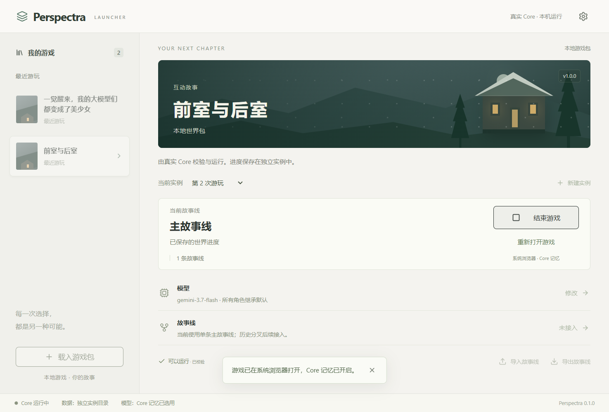

# Launcher 首轮真实 Core 接入

> **怎么读这一页。** 本页从 2026-10-06 首轮接入记录起步，后面多次补充。Launcher 的交互流程与数据边界已多次更新；2026-11-17 起默认记忆运行时改为 Node worker，不再依赖随包 Python。首轮和 2026-10-17 的验证记录保留为历史证据，不表示当前二进制或便携包已重建。故事线的当前行为见[故事线](storylines.md)，便携包的发布门禁见 [发行构建说明](../../scripts/release/BUILD.md)。

## 当前 Launcher 长什么样（2026-10-17 改版，当前源码）

- **首页**：铺满窗口的世界包封面；左侧细栏是各世界包的小图标；左下是包名和三个可点的状态标签（故事线、模型、前端权限：沙箱 / 已信任 / 官方模板）；右下是“开始游戏 / 继续游戏”。
- **本局抽屉**：点“⋯”或状态标签，右侧滑出半透明抽屉，含存档、模型、角色预设、前端权限、运行参数、透视。每项在抽屉里翻页编辑，不再一层层叠对话框。
- **设置窗口**：右上角 ⚙，含模型接口、外观、阅读与声音、数据位置、关于。底部“取消 / 应用 / 保存”只管外观、阅读与声音；模型接口的修改即时保存。
- **游戏运行中**：主按钮变“结束游戏”，旁边是“回到游戏页面”和“打开创作者页面”。设置仍可修改，界面提示“修改将在下次启动游戏时生效”。切包、切实例、切换故事线、导入存档和授予前端信任要先结束游戏；撤销信任立即生效。

源码：[LauncherShell](../../apps/launcher/src/components/LauncherShell.vue)、[HomeStage](../../apps/launcher/src/components/HomeStage.vue)、[PackRail](../../apps/launcher/src/components/PackRail.vue)、[SessionDrawer](../../apps/launcher/src/components/SessionDrawer.vue)、[SettingsWindow](../../apps/launcher/src/components/SettingsWindow.vue)；原有对话框通过 [DialogFrame](../../apps/launcher/src/components/DialogFrame.vue) 的内嵌模式放进抽屉和设置窗口。

验证范围：启动器单测、浏览器 Mock 预览、真实 playtest 服务器（创作者页、保存接口）。Tauri 无边框窗口实机点击、真实模型试玩和发行包未验收。

模型连接（2026-10-17）：可保存多条连接，Key 存 Windows 凭据管理器；每个实例选自己的模型，角色决策与记忆整理还能按角色分别选，见[模型接口协议](model-protocols.md)。

### Node Core 运行时（2026-11-17 当前源码）

Launcher 继续以 Rust 启动本机 Node 桥接；桥接启动网页 Core Host。Host 默认使用官方 Node Memory Core，Core 和 E5 编码分别运行在 Node worker_threads 中。源码开发时 worker 从 `packages/memory-core/src/node/*.ts` 启动；隔离发行布局使用 `runtime/memory-core/node/*.mjs`，ONNX CPU 原生库由 `runtime/node_modules/onnxruntime-node` 与 `onnxruntime-common` 提供。E5 固定资产放在 `runtime/models/e5-small`，也可通过 `HCW_HINDSIGHT_ONNX_DIR` 指向本地目录。运行时不下载模型或启动 Python。

首次开发准备可运行 `node scripts/setup-memory-assets.mjs`；该命令只负责开发／构建时准备六个固定资产，实际目录按 `HCW_HINDSIGHT_ONNX_DIR` 或默认 `.tmp/hindsight-e5-small` 选择。它们以根部 `packages/memory-core/e5-assets.json` 校验，构建后复制到 Node runtime。发行布局验证命令为 `node scripts/release/verify-core-layout.mjs`，会实际启动源码 TS、仓库 cwd 的 bundled backend（无 `PERSPECTRA_RUNTIME_ROOT`）与隔离 Node runtime 三种布局，并对每种布局执行 Core worker、384 维 CPU E5 编码及默认 Core HTTP Host 检查。

## 首轮接入记录（2026-10-06）

| 属性 | 内容 |
| --- | --- |
| 日期 | 2026-10-06 |
| 范围 | v5 源目录 → 独立实例 → OpenAI 兼容模型 → Core 记忆 → 系统浏览器 → 停止/续玩 |
| 用户决定 | 本轮只做上述闭环；故事线分叉与分享禁用；游戏在系统浏览器打开；启用近期优化的 Core 记忆 |
| 实际验证 | 真实模型一次玩家输入、两次角色调用；原生窗口启停/续玩；正常退出与强制退出清理 |
| 发布边界 | 当前源码工作区运行，尚未制作可独立分发的安装包 |

此前的 [V1 Mock 交付说明](launcher-v1.md) 与 [Mock 原生验收](launcher-v1-validation.md) 保留第一阶段记录。本页描述后续真实接入，不将那些示例历史视为真实 Core 数据。

## 1. 当前可用流程

在仓库根目录运行：

```powershell
# 首次准备依赖，沿用仓库已有 Node 和 pnpm
corepack pnpm@11.7.0 install --frozen-lockfile

# 原生开发窗口
corepack pnpm@11.7.0 launcher:desktop

# 或构建并运行调试程序
corepack pnpm@11.7.0 --filter @perspectra/launcher tauri build --debug --no-bundle
& '.\apps\launcher\src-tauri\target\debug\perspectra-launcher.exe'
```

本机需要 Node 24、Rust/Cargo 和六个固定 E5 资产。开发环境无需为默认 Core 安装 Python。Rust 的 Cargo 若未进入当前终端 PATH，重新打开终端。

Core 默认从 `.tmp/hindsight-e5-small` 读取本地 E5 资产；可用 `HCW_HINDSIGHT_ONNX_DIR` 覆盖。未准备齐六个固定文件时，Host 会在 Core 启动前报告缺失资产。便携运行时把资产放在 `runtime/models/e5-small` 并设置对应目录，不使用 Python 可执行文件、`HCW_HINDSIGHT_PYTHON` 或 Python Core 路径。

2026-10-17 历史验证：最近两个已游玩实例只读预检均为 resume，包 Hash 匹配；最近实例的独立副本经 LauncherCore 启动成功，页面 200、未鉴权状态接口 401、66 条历史可读，模型调用 0，正常停止。当时的 Python/E5 离线编码结果只描述旧运行时，不能作为当前 Node runtime 的验收证据；原存档未写入。

2026-11-17 Node 切换验收：主线报告默认 Host 集成已通过，覆盖 4 个角色、非空真实 E5 build/recall、save/restore/recall，且测试环境没有 Python 可执行文件。本轮发行任务另在 `.tmp/core-layout-0ygqoK/result.json` 记录三布局启动、Core worker 与本地 E5 编码均通过；三次 HTTP 状态均为 200，默认 `memoryMode` 为 `core`，没有外部模型请求。`tests/host/package-layout.test.ts` 的 5 项测试通过，检查 Node worker、平台原生依赖、发行 Skill 过滤器及 Python 路径缺席。

本轮没有运行 Cargo/Tauri 构建，没有替换 Launcher EXE，也没有生成或重发完整便携包。因此这些检查只证明当前源码与隔离 Node runtime 布局；已有 launcher.exe 或 ZIP 是否包含 Rust 源码改动，仍取决于它们各自的构建时间。

2026-10-17 核对 Windows 开发启动：例如 Vite 和 Rust 编译成功后，窗口创建却报 WebView2 `0x800700AA`「请求的资源在使用中」，本机已复现为开发目录产物继承低完整性标签。同一份 EXE 放在正常用户应用目录后可创建窗口。[开发启动脚本](../../apps/launcher/scripts/desktop.mjs)因此为 Windows 的 `launcher:desktop` 默认设置 `CARGO_TARGET_DIR=%LOCALAPPDATA%/Perspectra/launcher-dev-target`，只调整原生开发构建输出位置；已有显式 `CARGO_TARGET_DIR` 保持不变，直接调用 `tauri build` 的输出位置也不变。未修改工作区、WebView2 安装或游戏数据目录的权限。修复后以新实验数据目录运行实际 `launcher:desktop --no-watch`，Rust 编译并从上述目录运行，Perspectra 窗口创建成功且保持响应，Node 桥接与数据目录初始化成功；Launcher 类型检查及 39 项测试、脚本语法与 Lint、文档链接通过。验收窗口已关闭且 1420 端口释放；没有启动游戏，不替代真实模型和完整玩法验收。

首次启动显示空游戏列表。点击“载入游戏包”，选择包含 `worldpack.source.json` 的目录，例如 `examples/world-packs/ai-girls-awaken-v10`。载入时复用 v5 编译器及网页资源检查，随后创建首个独立实例。

例子：玩家在“模型设置”添加“本地 8046 网关”和“DeepSeek 官方”两条连接，并给后者填 API Key；之后在某个实例的“模型 → 修改”里选连接“DeepSeek 官方”，从下拉列表挑 `deepseek-flash` 保存，开始游戏即可，不需要复制模型名。

想只给重要角色使用强模型时，在同一弹窗的“按角色单独设置”取消该角色的“跟随默认”，另选连接、模型和思考强度。记忆整理默认跟随该角色决策，也可取消勾选后另选。未单独配置的角色使用实例默认决策和默认记忆模型；这些选择在下次启动生效。

连接（名称、协议、完整地址）保存在 `launcher.json` 的 `connections`；实例保存 `models.decision`（连接 ID、模型、思考强度）。新实例沿用最近一次保存的实例选择；从未保存过时，Launcher 用第一条连接列出的第一个模型；没有连接时实例显示“尚未设置”，开始前须先选模型。删除仍被引用的连接需二次确认，引用它的实例显示“连接已删除”且拒绝启动。API Key 按连接存入 Windows 凭据管理器（`Perspectra` / `model-connection/<连接 ID>`），由 Rust 桥在列模型、测试和启动请求里注入，网页和 Node 都不保存。

“开始游戏”启动真实 Core 后打开系统浏览器。“结束游戏”关闭 Core，已提交进度保留；“继续游戏”重新打开同一实例。浏览器关闭不会停止 Core，Launcher 中可重新打开游戏。关闭 Launcher 会停止其拥有的游戏进程。

删除实例（2026-10-25）：本局抽屉的实例选择旁有“删除实例”，确认后删除该实例的索引记录、`instances/<实例 ID>` 下的全部存档、故事线与节点、它的角色预设分配和前端授权，不能恢复。游戏运行中不能删除。先删索引再删文件，删文件中途失败时不会留下指向损坏存档的实例。

`launcher:dev` 仍是浏览器展示预览，不能调用原生运行命令；真实运行请使用 Tauri。

## 2. 实现与文件边界

| 文件 | 实现 |
| --- | --- |
| [apps/launcher/backend/core.ts](../../apps/launcher/backend/core.ts) | 读取/原子保存 Launcher 索引，校验包，创建实例元数据，保存模型配置，拥有游戏子进程，处理就绪与停止 |
| [apps/launcher/backend/entry.ts](../../apps/launcher/backend/entry.ts) | Tauri 与 Node 的本机 stdio 请求入口；一次串行处理一个操作；不转发私有 Core 输出 |
| [main.rs](../../apps/launcher/src-tauri/src/main.rs) | 仅 main 窗口可调用命令；启动 Node 桥接；校验本机游戏 URL 后打开浏览器；Windows Job Object 保证拥有的 Core 进程树随 Launcher 退出 |
| [Cargo.toml](../../apps/launcher/src-tauri/Cargo.toml)、Cargo.lock | JSON 通信及 Windows Job Object 所需依赖 |
| [core-types.ts](../../apps/launcher/src/core-types.ts) | 包/实例的公开 Launcher 元数据及真实状态 DTO |
| [desktop.ts](../../apps/launcher/src/services/desktop.ts) | 原生目录选择、Core 请求、浏览器打开 |
| [launcher.ts](../../apps/launcher/src/stores/launcher.ts) | 原生启动空索引，读取真实数据；阻止并发界面操作；低频刷新进程状态；会话密钥按接口隔离 |
| [types.ts](../../apps/launcher/src/types.ts) | 增加真实 Core 状态，保留此前 Mock 展示类型 |
| LauncherShell、GameList、GameDetail（2026-10-17 已由 HomeStage、PackRail、SessionDrawer 取代） | 真实状态与启停；首次空状态和重试；故事线/分享明确禁用 |
| ImportDialog、ModelConfigDialog、SettingsDialog | v5 目录载入，实例模型，全局默认及会话密钥 |
| [launcher-core.test.ts](../../tests/desktop/launcher-core.test.ts) | 5 项实例索引、配置损坏、无效包、权限及认证字段回归 |
| [launcher.test.ts](../../apps/launcher/src/stores/launcher.test.ts) | 2 项原生初始化和跨接口密钥隔离回归 |

没有修改 Core 的 Action、Rulebook、Event 提交、角色权限或记忆算法；继续调用现有 `apps/host/src/runtime/web-entry.ts`。旧 Electron 桌面入口已于 2026-10-21 删除，其存档和设置未迁移。

## 3. 数据与进程

便携包（EXE 旁有 runtime 目录）自 0.3.5 起默认根目录为程序目录下的 `data`，便于整体搬移且不占用系统盘用户目录；源码开发启动仍用 Tauri 的应用数据目录。`PERSPECTRA_LAUNCHER_DATA_DIR` 和设置中保存的数据位置（仍记在应用配置目录的 launcher-location.json）优先于默认值。旧版本默认目录中的实例不自动搬迁，需在设置中指回该目录。设置中显示实际路径：

```text
<程序目录>/data/
├─ launcher.json
└─ instances/
   └─ <本地 UUID>/
      ├─ world.sqlite
      ├─ 既有 Core 的其他存储与日志
      └─ memory-core/
```

`launcher.json` 保存包 ID、版本、路径及实际编译 Hash，实例 ID、名称、包引用、最后启动时间、实例模型选择、模型连接和最近一次的模型选择。旧版单接口索引（`defaults` 与实例 `model`）在首次加载时一次性迁移为连接，原文件备份为同目录 `launcher.backup-<时间>.json`；迁移后的连接没有 Key，需要在模型设置补填一次。保存通过临时文件加 rename 完成；损坏时明确失败，不覆盖原索引。新实例仅创建索引项，首次开始游戏才初始化世界数据。

包内容不复制到实例、不由 Launcher 修改。开始游戏前复用现有只读存档预检；包 Hash 改变或不兼容时拒绝继续。实例目录只能从索引中的本地 UUID 派生，不接受前端传入任意存档路径。

2026-10-17 修复包故障隔离：例如一个已载入游戏的目录被移动，Launcher 仍能打开，其他游戏仍可选择。初始化和刷新包推荐时逐包检查源码与包内 `model-preset.json`；失败包保留索引与实例，清除派生的角色列表、推荐、说明和封面，通过 `packDetails[包 ID].error` 让界面显示校验失败并禁止开始。恢复文件后重新载入相同包可清除错误，不删除存档。`launcher.json`、全局预设设置和预设库自身损坏仍明确失败，不以空配置替代。该修复有缺失目录、损坏源码、损坏包预设和重新载入的自动回归，尚未在原生窗口实测或重建发行包。

API Key 不进入索引、包、参数列表或分享对象；启动时 Rust 桥从凭据管理器读出，经 stdio 请求交给 Node。Node 用 `PERSPECTRA_ROLE_MODELS` 传递已解析的默认及角色决策／记忆目标（不含 Key），用 `PERSPECTRA_MODEL_KEYS` 只传递这些目标引用的连接 Key。2026-10-27 起默认决策也只从前者读取，不再另传 `HCW_LOCAL_*`；Launcher 启动子进程时会清空自身环境里的 `HCW_LOCAL_*` 与 `PERSPECTRA_MODEL_*`。游戏入口在内存中合并目标与 Key，随即删除 `process.env.PERSPECTRA_MODEL_KEYS`；每个 Node Core worker 只接收其所用模型的配置，不继承另一连接的 Key，E5 编码 worker 不接收模型凭证。各角色的决策目标整体替换，不继承默认连接的 Key 或思考强度。

记忆按协议、地址、模型和 Key 相同的配置复用一组 runner；每组有按需启动的召回 worker，以及独立的后台整理 worker。角色档案、授权 Source 和 scope 仍分别传入，模型相同不合并记忆；不同配置可能各加载一份 E5，接受额外内存开销。Core 自己管理已提交数据；Launcher 不返回角色私有 Context、记忆档案或模型正文。私有调查日志仍遵循现有运行时说明。

进程关系为 Tauri → Node 桥接与网页 Core → Core/E5 Node worker_threads。停止首先使用已有 IPC shutdown，超过等待期限才清理自己拥有的游戏进程树。Windows Job Object 用于 Launcher 意外退出时回收桥接及其后代，不承担未提交反应的精确恢复。

本机验收可通过环境变量 `PERSPECTRA_LAUNCHER_DATA_DIR` 指定新的实验根目录。正常用户无需设置。所有本轮实验都使用仓库 `.tmp` 中新建目录，没有写入 `D:/worlds` 或旧 Electron 存档。

## 4. 实际界面



真实实例只显示“主故事线”与“已保存的世界进度”；没有从数据库接入历史轮数，因此不显示虚构轮数。插画仍是 Launcher 的通用装饰，没有宣称从包中读取封面。

## 6. 首轮验收记录（2026-10-17）

| 检查 | 结果 |
| --- | --- |
| AI 美少女 2.4.1 包编译校验 | valid |
| 仓库默认 check | 类型/Lint、28 文件、201 项测试通过 |
| Launcher check | strict 类型、2 文件、8 项测试通过 |
| Tauri 调试构建 | 通过，默认构建未加入调试端口 |
| 少量真实模型链路 | “前室与后室”：一次玩家输入，两次角色请求，均发表回复，网页返回 200 |
| Core 记忆 | 真实 state.debug.memoryMode = core |
| 鉴权 | 未提供网页令牌的状态请求返回 401 |
| 真实续玩 | 0 条转录 → 3 条转录；停止并以新 LauncherCore 对象重新读取实例后，仍是 3 条 |
| 原生 WebView | 实际 tauri.localhost 页面：包载入、模型保存、启停/继续、重新读取索引通过 |
| 原生目录选择 | Windows 文件夹选择返回 prototype-g1 目录，并完成前端“校验并载入” |
| 系统浏览器 | 真实 Edge 出现“Perspectra 试玩”页面；Launcher 保持独立 |
| 独立实例 | 两个包、三个本机测试实例重启后恢复；实例模型配置独立 |
| 凭证 | 原生测试值不在 launcher.json；跨接口密钥转发受回归验证 |
| 退出 | 运行中正常关闭 Launcher 后拥有的进程全部退出；运行中强制终止 Launcher 后拥有的进程也全部退出 |
| 控制台 | 原生验收无应用 error/warning；Chromium 有 password 控件的 verbose 提示 |

真实模型证据在忽略目录 `.tmp/launcher-core-smoke-result.json`，其中 providerCalls = 2、memoryMode = core、resumedTranscript = 3。本次没有触发长期记忆后台整理，因此不把这次运行描述为再次验收后台整理算法。后台整理沿用既有实现与已有验收。

原生脚本位于 `.tmp/launcher-core-verify/`；截图原始文件位于 `output/playwright/launcher-core-native-main.png` 与 `launcher-core-native-running.png`。验收用临时 WebView 调试配置不进入交付配置。

## 7. 当前接受的限制

- 旧 Python Core 与 Node Core 的运行时身份不同，旧快照／story node 不承诺跨运行时兼容；身份检查保持严格，不自动重写历史存档。此切换不扫描、修改或自动迁移 `D:/worlds`。
- 本轮没有重建 Tauri Launcher EXE 或完整发行包；需要使用包含本次 Rust 与 Node payload 改动的构建产物，不能仅替换随包文档来升级运行时。
- 只接受 v5 世界包源目录，不接受 ZIP；不自动迁移旧世界。2026-10-25 起同 ID 的包内容变了（作者改了包文件）时，启动器启动或重新载入会更新记录的包指纹：还没玩过的实例开始时直接采用当前包；已有进度的实例拒绝开始，提示新建实例或恢复原包。
- 每个实例一个主分支；历史分叉、故事线导入导出、角色独立模型映射与独立连接测试均未接入。
- 已接通 OpenAI 兼容、Anthropic Messages 与 Google Gemini 原生协议；配置、预设差异和真实模型验收限制见[模型接口协议](model-protocols.md)。Launcher 未接入 Ollama 专用协议、Vertex AI 或 OAuth。
- 全局模型变更只影响新实例；同一会话密钥按接口匹配，不保存到系统凭证库，重启需重新填写。
- 页面元数据的最后游玩时间表示最近成功启动；不等同于最后一次世界事件提交时间。
- 本次模型验证只有一轮，未重新验收连续 G3 玩法、跨地点认知隔离、后台整理高水位与长时间性能。

后续游戏前端已改为 frontend/ 显式 manifest 与 iframe 沙箱，公共玩家接口不传递 Core 令牌；详见 [前端最小沙箱实验](frontend-v1.md)。旧 web/ 的直接 API 约定不再适用。
