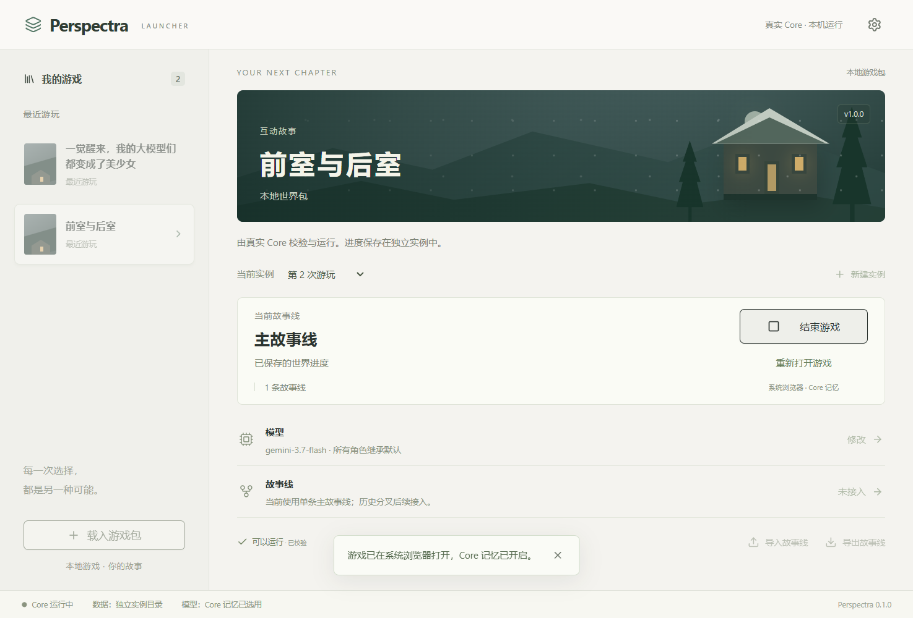

# Launcher 首轮真实 Core 接入

> 2026-10-07 更新：本文保留首轮接入时的验收记录。当前已有故事线、预设、前端授权、独立连接测试及 Windows x64 便携候选包；下文旧版“依赖本机源码”“分叉和连接测试未接入”不再描述当前版本。现状与未通过的发布门禁见 [便携候选版验收](studies/launcher-portable-release-20261007.md)。

> 本页保留 2026-10-06 首轮记录。当前已接通本地完整节点、分叉、切换和单节点分享；2026-10-15 源码支持运行中保存并导出、分享节点当时的长期档案，恢复不额外调用模型整理。当前行为及与旧发行包的区别见[故事线](storylines.md)。下文首轮限制不代表当前能力。

> 2026-10-17 启动器改版（当前源码）：例如玩家打开启动器，看到的是铺满窗口的世界包封面，左侧细栏是各个世界包的小图标，左下是包名和三个可点的状态标签（故事线、模型、前端权限：沙箱 / 已信任 / 官方模板），右下是“开始游戏 / 继续游戏”。点“⋯”或状态标签，右侧滑出半透明的本局抽屉：存档、模型、角色预设、前端权限、运行参数、创作者工具，每一行在抽屉里翻页编辑，不再叠对话框。右上角 ⚙ 打开设置窗口：模型接口、外观、阅读与声音、数据位置、关于，底部“取消 / 应用 / 保存”只作用于外观、阅读与声音，模型接口仍即时保存。游戏运行中主按钮变“结束游戏”，旁边是“回到游戏页面”和“打开创作者页面”；设置可以继续修改，抽屉与设置窗口提示“修改将在下次启动游戏时生效”，切包、切实例、切换故事线、导入和授予前端信任仍要先结束游戏，撤销信任立即生效。源码：[LauncherShell](../../apps/launcher/src/components/LauncherShell.vue)、[HomeStage](../../apps/launcher/src/components/HomeStage.vue)、[PackRail](../../apps/launcher/src/components/PackRail.vue)、[SessionDrawer](../../apps/launcher/src/components/SessionDrawer.vue)、[SettingsWindow](../../apps/launcher/src/components/SettingsWindow.vue)；原有对话框通过 [DialogFrame](../../apps/launcher/src/components/DialogFrame.vue) 的内嵌模式放进抽屉和设置窗口。已用启动器单测、浏览器 Mock 预览和真实 playtest 服务器（创作者页、保存接口）核对；Tauri 无边框窗口实机、真实模型试玩与发行包未验收。

> 2026-10-17 核对模型连接与按角色模型选择：第 1、3 节已同步当前源码；第 5 节及第 6 节的首轮限制保留历史记录。连接 Key 现存 Windows 凭据管理器，角色决策与记忆可分别选模型；本轮未重建发行包。

| 属性 | 内容 |
| --- | --- |
| 日期 | 2026-10-06 |
| 范围 | v5 源目录 → 独立实例 → OpenAI 兼容模型 → Core 记忆 → 系统浏览器 → 停止/续玩 |
| 用户决定 | 本轮只做上述闭环；故事线分叉与分享禁用；游戏在系统浏览器打开；启用近期优化的 Core 记忆 |
| 实际验证 | 真实模型一次玩家输入、两次角色调用；原生窗口启停/续玩；正常退出与强制退出清理 |
| 发布边界 | 当前源码工作区运行，尚未制作可独立分发的安装包 |

此前的 [V1 Mock 交付说明](launcher-v1.md) 与 [Mock 原生验收](launcher-v1-validation.md) 保留第一阶段记录。本页描述后续真实接入，不将那些示例历史视为真实 Core 数据。

## 1. 当前可用流程

在仓库根目录运行：

```powershell
# 首次准备依赖，沿用仓库已有 Node 和 pnpm
corepack pnpm@11.7.0 install --frozen-lockfile

# 原生开发窗口
corepack pnpm@11.7.0 launcher:desktop

# 或构建并运行调试程序
corepack pnpm@11.7.0 --filter @perspectra/launcher tauri build --debug --no-bundle
& '.\apps\launcher\src-tauri\target\debug\perspectra-launcher.exe'
```

本机需要 Node 24、Rust/Cargo，以及现有 Core 记忆的 Python/E5 环境；环境准备沿用 [记忆实验说明](../../experiments/activity-memory/README.md)，不重新建设运行时。Rust 的 Cargo 若未进入当前终端 PATH，重新打开终端。

开发入口默认检查 Windows 的 `.tmp/hindsight-vector-venv/Scripts/python.exe`，E5 权重默认读取 `.tmp/hindsight-e5-small`；可分别用 `HCW_HINDSIGHT_PYTHON` 与 `HCW_HINDSIGHT_ONNX_DIR` 覆盖，再重启启动器。缺少 Python 时现在显示明确的准备提示，不再只显示“本机操作失败”，并且在启动 Core 或改变实例进度前退出。当前源码工作区本机缺失的两个目录已用目录链接复用现有便携候选包的 Python 与 E5：候选包目录需要保留，移动后须重建链接或设置覆盖路径；不将本机链接打包或写入版本控制。

2026-10-17 验证：最近两个已游玩实例只读预检均为 resume，包 Hash 匹配；最近实例的独立副本经真实 LauncherCore 启动成功，页面 200、未鉴权状态接口 401、66 条历史可读，模型调用 0，正常停止。Python/E5 离线编码形状 `[1,384]` 且数值有限。此项只验证继续启动，不验证新一轮真实模型表现；原存档未写入。

2026-10-17 核对 Windows 开发启动：例如 Vite 和 Rust 编译成功后，窗口创建却报 WebView2 `0x800700AA`「请求的资源在使用中」，本机已复现为开发目录产物继承低完整性标签。同一份 EXE 放在正常用户应用目录后可创建窗口。[开发启动脚本](../../apps/launcher/scripts/desktop.mjs)因此为 Windows 的 `launcher:desktop` 默认设置 `CARGO_TARGET_DIR=%LOCALAPPDATA%/Perspectra/launcher-dev-target`，只调整原生开发构建输出位置；已有显式 `CARGO_TARGET_DIR` 保持不变，直接调用 `tauri build` 的输出位置也不变。未修改工作区、WebView2 安装或游戏数据目录的权限。修复后以新实验数据目录运行实际 `launcher:desktop --no-watch`，Rust 编译并从上述目录运行，Perspectra 窗口创建成功且保持响应，Node 桥接与数据目录初始化成功；Launcher 类型检查及 39 项测试、脚本语法与 Lint、文档链接通过。验收窗口已关闭且 1420 端口释放；没有启动游戏，不替代真实模型和完整玩法验收。

首次启动显示空游戏列表。点击“载入游戏包”，选择包含 `worldpack.source.json` 的目录，例如 `examples/world-packs/ai-girls-awaken-v10`。载入时复用 v5 编译器及网页资源检查，随后创建首个独立实例。

例子：玩家在“模型设置”添加“本地 8046 网关”和“DeepSeek 官方”两条连接，并给后者填 API Key；之后在某个实例的“模型 → 修改”里选连接“DeepSeek 官方”，从下拉列表挑 `deepseek-flash` 保存，开始游戏即可，不需要复制模型名。

想只给重要角色使用强模型时，在同一弹窗的“按角色单独设置”取消该角色的“跟随默认”，另选连接、模型和思考强度。记忆整理默认跟随该角色决策，也可取消勾选后另选。未单独配置的角色使用实例默认决策和默认记忆模型；这些选择在下次启动生效。

连接（名称、协议、完整地址）保存在 `launcher.json` 的 `connections`；实例保存 `models.decision`（连接 ID、模型、思考强度）。新实例沿用最近一次保存的实例选择；从未保存过时，Launcher 用第一条连接列出的第一个模型；没有连接时实例显示“尚未设置”，开始前须先选模型。删除仍被引用的连接需二次确认，引用它的实例显示“连接已删除”且拒绝启动。API Key 按连接存入 Windows 凭据管理器（`Perspectra` / `model-connection/<连接 ID>`），由 Rust 桥在列模型、测试和启动请求里注入，网页和 Node 都不保存。

“开始游戏”启动真实 Core 后打开系统浏览器。“结束游戏”关闭 Core，已提交进度保留；“继续游戏”重新打开同一实例。浏览器关闭不会停止 Core，Launcher 中可重新打开游戏。关闭 Launcher 会停止其拥有的游戏进程。

`launcher:dev` 仍是浏览器展示预览，不能调用原生运行命令；真实运行请使用 Tauri。

## 2. 实现与文件边界

| 文件 | 实现 |
| --- | --- |
| [desktop/launcher-core.ts](../../desktop/launcher-core.ts) | 读取/原子保存 Launcher 索引，校验包，创建实例元数据，保存模型配置，拥有游戏子进程，处理就绪与停止 |
| [desktop/launcher-entry.ts](../../desktop/launcher-entry.ts) | Tauri 与 Node 的本机 stdio 请求入口；一次串行处理一个操作；不转发私有 Core 输出 |
| [main.rs](../../apps/launcher/src-tauri/src/main.rs) | 仅 main 窗口可调用命令；启动 Node 桥接；校验本机游戏 URL 后打开浏览器；Windows Job Object 保证拥有的 Core 进程树随 Launcher 退出 |
| [Cargo.toml](../../apps/launcher/src-tauri/Cargo.toml)、Cargo.lock | JSON 通信及 Windows Job Object 所需依赖 |
| [core-types.ts](../../apps/launcher/src/core-types.ts) | 包/实例的公开 Launcher 元数据及真实状态 DTO |
| [desktop.ts](../../apps/launcher/src/services/desktop.ts) | 原生目录选择、Core 请求、浏览器打开 |
| [launcher.ts](../../apps/launcher/src/stores/launcher.ts) | 原生启动空索引，读取真实数据；阻止并发界面操作；低频刷新进程状态；会话密钥按接口隔离 |
| [types.ts](../../apps/launcher/src/types.ts) | 增加真实 Core 状态，保留此前 Mock 展示类型 |
| LauncherShell、GameList、GameDetail（2026-10-17 已由 HomeStage、PackRail、SessionDrawer 取代） | 真实状态与启停；首次空状态和重试；故事线/分享明确禁用 |
| ImportDialog、ModelConfigDialog、SettingsDialog | v5 目录载入，实例模型，全局默认及会话密钥 |
| [launcher-core.test.ts](../../tests/prototype/launcher-core.test.ts) | 5 项实例索引、配置损坏、无效包、权限及认证字段回归 |
| [launcher.test.ts](../../apps/launcher/src/stores/launcher.test.ts) | 2 项原生初始化和跨接口密钥隔离回归 |

没有修改 Core 的 Action、Rulebook、Event 提交、角色权限或记忆算法；继续调用现有 `tests/experiments/playtest-web-entry.ts`。旧 Electron 桌面入口仍保留，但其存档和设置不迁移到新 Launcher。

## 3. 数据与进程

默认根目录由 Tauri 的应用数据目录提供，设置中只读显示实际路径：

```text
应用数据目录/
├─ launcher.json
└─ instances/
   └─ <本地 UUID>/
      ├─ world.sqlite
      ├─ 既有 Core 的其他存储与日志
      └─ memory-core/
```

`launcher.json` 保存包 ID、版本、路径及实际编译 Hash，实例 ID、名称、包引用、最后启动时间、实例模型选择、模型连接和最近一次的模型选择。旧版单接口索引（`defaults` 与实例 `model`）在首次加载时一次性迁移为连接，原文件备份为同目录 `launcher.backup-<时间>.json`；迁移后的连接没有 Key，需要在模型设置补填一次。保存通过临时文件加 rename 完成；损坏时明确失败，不覆盖原索引。新实例仅创建索引项，首次开始游戏才初始化世界数据。

包内容不复制到实例、不由 Launcher 修改。开始游戏前复用现有只读存档预检；包 Hash 改变或不兼容时拒绝继续。实例目录只能从索引中的本地 UUID 派生，不接受前端传入任意存档路径。

2026-10-17 修复包故障隔离：例如一个已载入游戏的目录被移动，Launcher 仍能打开，其他游戏仍可选择。初始化和刷新包推荐时逐包检查源码与包内 `model-preset.json`；失败包保留索引与实例，清除派生的角色列表、推荐、说明和封面，通过 `packDetails[包 ID].error` 让界面显示校验失败并禁止开始。恢复文件后重新载入相同包可清除错误，不删除存档。`launcher.json`、全局预设设置和预设库自身损坏仍明确失败，不以空配置替代。该修复有缺失目录、损坏源码、损坏包预设和重新载入的自动回归，尚未在原生窗口实测或重建发行包。

API Key 不进入索引、包、参数列表或分享对象；启动时 Rust 桥从凭据管理器读出，经 stdio 请求交给 Node。Node 用 `PERSPECTRA_ROLE_MODELS` 传递已解析的默认及角色决策／记忆目标（不含 Key），用 `PERSPECTRA_MODEL_KEYS` 只传递这些目标引用的连接 Key。默认决策仍使用 `HCW_LOCAL_*` 变量。游戏入口在内存中合并目标与 Key，随即删除 `process.env.PERSPECTRA_MODEL_KEYS`；每组 Python 记忆进程显式覆盖 `HCW_LOCAL_API_KEY`，无 Key 时传空串，不继承另一连接的默认 Key。各角色的决策目标整体替换，不继承默认连接的 Key 或思考强度。

记忆按协议、地址、模型和 Key 相同的配置复用一组 runner；每组有按需启动的召回 worker，以及独立启动的后台整理进程。角色档案、授权 Source 和 scope 仍分别传入，模型相同不合并记忆；不同配置可能各加载一份 E5，接受额外内存开销。Core 自己管理已提交数据；Launcher 不返回角色私有 Context、记忆档案或模型正文。私有调查日志仍遵循现有运行时说明。

进程关系为 Tauri → Node 桥接 → 既有网页 Core → 按需启动的 Python 记忆进程。停止首先使用已有 IPC shutdown，超过等待期限才清理自己拥有的游戏进程树。Windows Job Object 用于 Launcher 意外退出时回收桥接及其后代，不承担未提交反应的精确恢复。

本机验收可通过环境变量 `PERSPECTRA_LAUNCHER_DATA_DIR` 指定新的实验根目录。正常用户无需设置。所有本轮实验都使用仓库 `.tmp` 中新建目录，没有写入 `D:/worlds` 或旧 Electron 存档。

## 4. 实际界面



真实实例只显示“主故事线”与“已保存的世界进度”；没有从数据库接入历史轮数，因此不显示虚构轮数。插画仍是 Launcher 的通用装饰，没有宣称从包中读取封面。

## 5. 验收记录

| 检查 | 结果 |
| --- | --- |
| AI 美少女 2.4.1 包编译校验 | valid |
| 仓库默认 check | 类型/Lint、28 文件、201 项测试通过 |
| Launcher check | strict 类型、2 文件、8 项测试通过 |
| Tauri 调试构建 | 通过，默认构建未加入调试端口 |
| 少量真实模型链路 | “前室与后室”：一次玩家输入，两次角色请求，均发表回复，网页返回 200 |
| Core 记忆 | 真实 state.debug.memoryMode = core |
| 鉴权 | 未提供网页令牌的状态请求返回 401 |
| 真实续玩 | 0 条转录 → 3 条转录；停止并以新 LauncherCore 对象重新读取实例后，仍是 3 条 |
| 原生 WebView | 实际 tauri.localhost 页面：包载入、模型保存、启停/继续、重新读取索引通过 |
| 原生目录选择 | Windows 文件夹选择返回 prototype-g1 目录，并完成前端“校验并载入” |
| 系统浏览器 | 真实 Edge 出现“Perspectra 试玩”页面；Launcher 保持独立 |
| 独立实例 | 两个包、三个本机测试实例重启后恢复；实例模型配置独立 |
| 凭证 | 原生测试值不在 launcher.json；跨接口密钥转发受回归验证 |
| 退出 | 运行中正常关闭 Launcher 后拥有的进程全部退出；运行中强制终止 Launcher 后拥有的进程也全部退出 |
| 控制台 | 原生验收无应用 error/warning；Chromium 有 password 控件的 verbose 提示 |

真实模型证据在忽略目录 `.tmp/launcher-core-smoke-result.json`，其中 providerCalls = 2、memoryMode = core、resumedTranscript = 3。本次没有触发长期记忆后台整理，因此不把这次运行描述为再次验收后台整理算法。后台整理沿用既有实现与已有验收。

原生脚本位于 `.tmp/launcher-core-verify/`；截图原始文件位于 `output/playwright/launcher-core-native-main.png` 与 `launcher-core-native-running.png`。验收用临时 WebView 调试配置不进入交付配置。

## 6. 当前接受的限制

- 当前 exe 依赖本机 Node、仓库位置、node_modules、Python 与 E5；源码工作区闭环已接通，可独立分发的安装包尚未实现。
- 只接受 v5 世界包源目录，不接受 ZIP；不自动迁移旧世界、不自动替换同 ID 的不同内容包。
- 每个实例一个主分支；历史分叉、故事线导入导出、角色独立模型映射与独立连接测试均未接入。
- 已接通 OpenAI 兼容、Anthropic Messages 与 Google Gemini 原生协议；配置、预设差异和真实模型验收限制见[模型接口协议](model-protocols.md)。Launcher 未接入 Ollama 专用协议、Vertex AI 或 OAuth。
- 全局模型变更只影响新实例；同一会话密钥按接口匹配，不保存到系统凭证库，重启需重新填写。
- 页面元数据的最后游玩时间表示最近成功启动；不等同于最后一次世界事件提交时间。
- 本次模型验证只有一轮，未重新验收连续 G3 玩法、跨地点认知隔离、后台整理高水位与长时间性能。

后续游戏前端已改为 frontend/ 显式 manifest 与 iframe 沙箱，公共玩家接口不传递 Core 令牌；详见 [前端最小沙箱实验](frontend-v1.md)。旧 web/ 的直接 API 约定不再适用。
