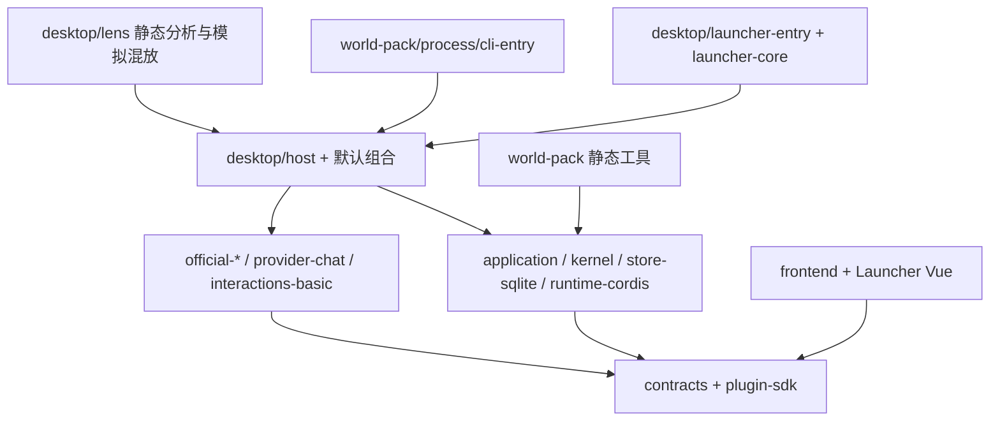

# B10 包边界与应用入口迁移

B9 已单独本地提交 `76d818dc2d5df6c8f8a0fd740c37a2d959ab77f4`，B10 从干净工作树开始，不推送、不发布、不进入 B11。提交前 B9 搜证正式 CLI 通过，执行段 363.9 ms（记录 `.tmp/composable-engine/b9/precommit.log`）。

## 迁移前的实际依赖

依据 30 个 packages/package.json、根与 Launcher 的 TS/Vite/Vitest 别名、desktop 的 imports、build-backend/build-worldpack-cli/copy-memory-runtime 以及正式入口测试核对。



实际问题：包名仍为 `@harness-world/*`；工具进程反向导入 desktop；Lens 类型依赖具体模拟类；官方默认组合静态导入 Python 记忆和 JEV 实验。构建与安装布局在多处写死旧路径。保留同一行为而收口这些依赖，是本批目的。

## 目标依赖与判断

```mermaid
flowchart TD
  Launcher[apps/launcher 管理进程与Vue] --> Host[apps/host 装配与Node入口]
  Host --> Core[@perspectra/core 子入口]
  Host --> Providers[@perspectra/providers 能力子入口]
  Host --> Plugins[@perspectra/plugins 玩法子入口]
  Host --> Pack[@perspectra/world-pack 静态工具/Lens分析]
  Host --> Front[@perspectra/frontend]
  Host -.显式选择.-> Memory[@perspectra/memory-core]
  Host -.启用实验.-> Audit[JEV独立实验入口]
  Core --> SDK[@perspectra/sdk / contracts]
  Providers --> SDK
  Plugins --> SDK
  Plugins --> Pure[core/interactions 纯交互实现]
  Pack --> PureCore[core/kernel 纯编译定义]
  Front --> SDK
  LauncherUI[Launcher浏览器] --> Browser[chat纯预设 / Lens纯辅助 / Host纯设置出口]
  Memory --> SDK
```

按实际职责合并，不创建把所有能力一次性加载的大 barrel：

- SDK 合并 contracts 与 plugin-sdk，原生作者入口为 sdk，基础契约为 sdk/contracts。
- Core 保留 application、kernel、store、runtime、memory、interactions、presentation、agents 子入口。它们是真实内部依赖边界，不强行把已有导出拍平成一层。
- Providers 用活动、状态、知识、决策上下文、角色循环、调度、通信、模型和聊天子入口；浏览器仅访问 chat 的纯预设子入口。已有调度与自主提名协作保留，不在迁包时改行为。
- Plugins 收拢 RPG/TRPG、骰子、节奏和基础交互，按子入口导入；基础交互依赖 core/interactions 的纯执行实现有实际消费者，保留该公开边。
- memory-core 独立，Python资源布局与运行协议保留。JEV 实验与内部 testkit 不混入主干默认 barrel，保留独立入口。
- Host 的现有协调器使用 core 公共入口，放在 apps/host；Launcher 管理进程迁入 apps/launcher/backend。不改写协调算法，不新增玩法。
- world-pack/process CLI 装配迁往 apps/host；Lens静态view/ids/rpg-view/diff进入world-pack，具体模拟/会话/服务归Host。静态视图用最小结构输入，不能导入具体Host类。动态断言保留B9正式执行实现，先不为了目录对称新增抽象服务。

禁止边：SDK→实现；core→具体Provider/玩法/Host；world-pack静态→Host/模型/Python/实验；frontend或Launcher浏览器→Node适配；默认RP组合→JEV；跨包私有src深导入。以源码边界检查和实际打包metafile共同验证，不能只看package.json。

## 迁移顺序

1. 保留 B9 本地提交，收集当前路径与导出映射。
2. 移动包目录并保持具名公共子入口；同步workspace依赖、imports、类型/测试/浏览器别名。
3. 移动Host和Launcher进程；静态Lens下沉工具链、CLI装配上移Host，移除工具链反向应用依赖。
4. 拆开默认组合对模型/Python/JEV的可选加载，保持声明式校验入口轻量。
5. 更新构建、资源复制、边界检查、作者类型导出与当前文档；实际运行独立导入、无模型/Python静态校验、隔离安装目录入口。
6. 重跑 B9、相关宿主/核心/Launcher 回归和构建；主代理实施后独立 GPT-6.1 Sol 审查、修复复验。

迁移不保留旧npm包名的兼容壳：仓库仍实验开发，所有维护中的调用方一起迁移；持久插件ID、schemaVersion、事件、存档与CLI命令语义保持不变。源码目录变化和机器上的已发布便携包是不同范围，B10不声称Windows原生Tauri或B11发行验收。

## 实施与验证记录

B10 差异保留未提交。旧 30 个包收敛为 9 个 packages：七个参考职责，加独立实验 jev-audit 和内部 testkit。Host 与 Launcher 均为 workspace 应用。没有为旧 npm 名创建兼容壳；旧插件 ID、事件与存档协议、CLI 命令及便携产物名保持不变。

迁移中的实际修正：

- `tailRuntimeIdentity` 的源码根定位随 Host 深度调整；Creator／Lens 构建资产定位随应用目录调整。
- `world-pack` 的 activate 分支按需导入核心装配，静态校验不加载游戏 WorldHostRuntime、模型 SDK、Python 适配或实验实现。
- MemoryCore 只依赖 SDK 的 MemoryRequest；Host 单独的 memory-composition 在选择 Python 记忆时导入。默认组合只读 `/paths` 元数据。JEV 在显式启用后加载，环境中的审计 Key 仍在任何插件启动前移除。
- Lens 静态分析使用最小 LensOpening 结构；场景解析、执行与动态断言仍在 Host，保留 B9 已验证的正式链路，避免为了示意目录制造工具链→Host 的反向边。
- Launcher 原有两份纯设置共享代码通过 Host `/play-settings`、`/plugin-settings` 公共出口消费。实际 browser 打包闭包各只有对应设置文件，不含 Node。浏览器仍不能导入其他 Host 实现。
- 隔离后端测试采用 Launcher 正式 shutdown IPC 结束进程；原测试只发 SIGTERM 却保持 IPC 连接，会在 Linux Node 上等到测试超时。没有放宽启动或数据断言。

### 实际检查结果

环境：Linux，Node 24.19.0，pnpm 11.7.0；使用 `/tmp/perspectra-corepack` 和 `/tmp/perspectra-{data,cache}` 可写缓存。安装仅改变 workspace importer／链接，外部锁定依赖未升级。以下命令省略共同前缀 `COREPACK_HOME=/tmp/perspectra-corepack corepack pnpm@11.7.0`；详细本地日志在 `.tmp/composable-engine/b10/`。

| 命令／范围 | 真实结果 |
| --- | --- |
| `typecheck`、`lint`、`format:check` | 退出 0；Lint 保留旧代码警告，没有把警告记为消失 |
| `node scripts/check-host-boundaries.mjs` | 434 生产文件通过；包含旧包名、反向依赖、私有深导入、实验驱动、作者脚本与直接提交门禁；补 Launcher 浏览器和 Host 装配入口负例 |
| `test:related` 的 B9 原九文件，加 decision-seam、trpg-activity、rpg-turn-battle，`--maxWorkers=1` | 12 文件 171 项通过，171.09 s；正式提交、拒绝、观察／面板、原生／脚本、RPG 与角色流程均复用原测试 |
| `test:related tests/host/package-layout.test.ts tests/host/boundaries.test.ts` | 最终 2 文件 5 项通过；SDK／RPG 实际导出闭包、模型/Python模块禁止加载的静态校验、共享设置 browser 闭包、隔离 CLI 搜证 |
| `test:related tests/host/package-layout.test.ts tests/host/entry-layout.test.ts` | 复验时 2 文件 4 项通过（之后另加纯设置闭包用例）；包含源码、构建、隔离安装后端启动及状态读取 |
| `launcher:check` | Vue 类型检查与 9 文件 103 项通过 |
| `launcher:build` | Launcher、Creator、Lens 三个 Vite 入口均成功 |
| `desktop:build` | Node 后端构建与前端／Python源码资源复制成功 |
| `node scripts/release/verify-worldpack-cli.mjs` | 退出 0；中文和空格的隔离目录，version/help/validate/test/compile/inspect/activate/错误路径/lens-view；脚本报告 modelCalls=0、assertionsExecuted=0，不能冒充搜证动态断言（后者由上面的测试另验） |
| 正式 `worldpack simulate examples/world-packs/investigation examples/world-packs/investigation/scenario.json` | 退出 0，passed=true；两次接受、精力归零、证物唯一，第三次结构拒绝 INSUFFICIENT_ENERGY |
| Chromium 实际页面与管理入口 | 舞台点击搜查后精力 1、线索一封信；Creator 与 Lens HTTP 200、真实内容加载、pageErrors=[]；Launcher Node JSON snapshot 成功。截图／结果保留本任务临时日志目录 |

最终独立 CLI 的毫秒计时：startup 1530.77，setup 4.03，compile 100.01，initialize 455.51，execution 431.98，cleanup 5.21。startup 是 Node 当前进程启动至调用 runScenario 前，不含外层 pnpm，也不含最终输出序列化；执行段不含初始化，临时 SQLite 与清理单列。该云容器有并行检查负载，只作行为与时间边界记录，不据此宣称性能提升。

### 默认回归与限制

完整 `test` 确实运行过：250 文件，234 文件通过；2357 项通过、60 项失败、4 项跳过，346.60 s。没有报告全绿，也没有删测试来过关。

- 在 B9 提交的独立临时快照中，以同一 Node、同一已安装依赖复跑相同测试，复现其中 41 项失败（12 文件）：旧插件夹具缺少静态清单、隐式节奏／旧脚本预期、旧 plugin-set 数据、错误文案、Windows 专用授权与本容器缺少 Python 环境等。对照两份 baseline-comparison 日志，共 41 项失败、99 项通过。B10 不为通过这些历史断言恢复旧机制或引入兼容存档分支。
- 17 项由施工期间源码摘要变化触发；停止修改运行时代码后，相应三个文件与 B9 九文件一起重跑，171 项全过。
- 一项隔离入口超时已修正测试退出协议并复验通过。
- 一项节奏活动选择在首轮与定向复验间波动；B10 和 B9 定向复验均通过。保留此结果为非稳定旧场景限制，没有把单次复验提升为全默认回归稳定性证明。

文档检查运行 `node scripts/docs/check-links.mjs` 仍退出 1：104 条缺失链接报告、103 个历史本地资产缺席；对照 B9 并按路径迁移归一化后没有新增缺失，新的模块地图完整。历史 study 的旧文件失链未混入本批修复。

未安装／运行 Python E5 全栈，未调用真实计费模型，未验证 Windows 原生 Tauri、WebView2、完整 Windows 便携 ZIP 或 B11 发行。现有平台与基线失败保留为明确限制。

### 独立审查

按 AGENTS.md，由主代理实施，独立 GPT-6.1 Sol 子代理只读审查。发现一个 P2：Launcher 浏览器缺少生产依赖门禁。补纯公共设置出口、实际 browser 闭包测试及禁止 Node／实现包的负例，并恢复 Host 官方实现的明确装配入口集合。审查者独立复验生产边界 434 文件、2 文件 5 项测试通过，最终在审查范围内 PASS，无残余高／中优先级问题。其 PASS 不替代上面列出的整套回归限制。

### 对照阅读

在 B9 提交 `76d818dc` 查看旧路径，再按当前路径逐步读：

1. `packages/world-pack/process/cli-entry.ts` → `apps/host/src/cli/worldpack.ts` 的 simulate 分支。
2. `desktop/lens/scenario.ts`／simulation.ts → `apps/host/src/lens/` 的 runScenario／LensSimulation；脚本模型移至 `packages/providers/src/scripted-model/index.ts`。
3. `desktop/host/world-runtime.ts` → `apps/host/src/runtime/world-runtime.ts`；公共执行周期仍进入 `packages/core/src/application/execution-engine.ts`（旧 application）。
4. `gameplay-runtime.ts` → `round-coordinator.ts` → `packages/core/src/store/` 原子事实提交；这些核心算法主要只是 import 与目录迁移。
5. 回到 Lens 的 events／perceived／modelInputs／gameplay 和 scenario.check，核对结构拒绝、同房观察、房外隔离、私密线索与面板断言。静态视图则读 `packages/world-pack/src/lens/view.ts`，它不导入具体模拟类。

停在 B10；不推送、不创建 PR、不合并 main、不发布，B10 不与 B9 混为一个提交。
